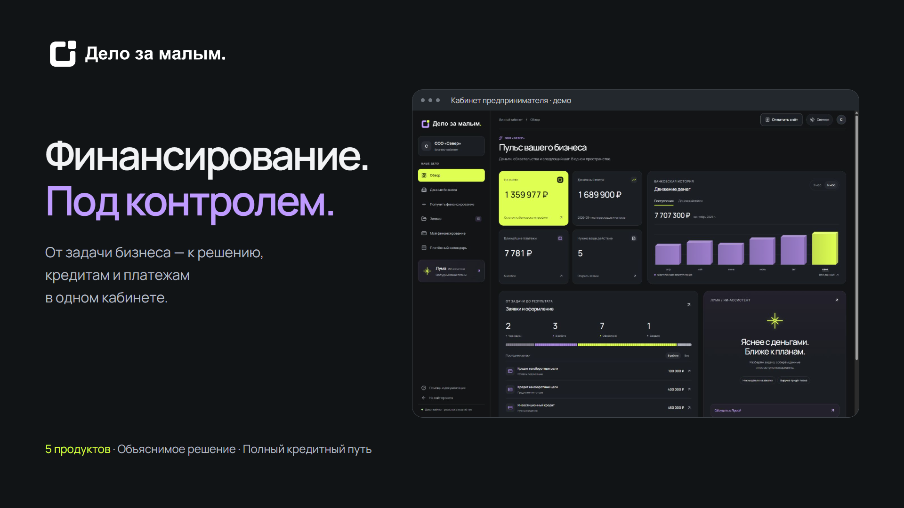

# Дело за малым

Умный кредитный кабинет для малого бизнеса: потребность → заявка → проверки → решение → финансирование и платежи.



**[Обзор решения](docs/PRODUCT.md) · [Запуск](#быстрый-запуск) · [Документация](docs/README.md) · [Комплект сдачи](docs/SUBMISSION.md)**

## Что реализовано

- Пять продуктов: оборотный и инвестиционный кредиты, овердрафт, кредитная линия и рефинансирование.
- Пошаговый подбор или Лума: параметры заявки появляются рядом с разговором и применяются после подтверждения.
- Сквозной процесс с проверками, объяснимым скорингом, расчётом нагрузки, уточнениями и итоговым решением.
- Обслуживание: долг, проценты, погашение, календарь, таймлайн и прогноз остатка денег по дням.
- PDF-счёт, проверка реквизитов и демонстрационная оплата поставщику.

[Выводы анализа, влияние на продукт и подтверждения](docs/PRODUCT.md) вынесены отдельно от технической документации.

## Быстрый запуск

Нужны **Git, Python 3.11+, Docker с Compose v2** и интернет для сборки. Docker должен быть запущен; Node.js и Python-зависимости на хост устанавливать не нужно.

```shell
git clone https://github.com/xMewrizz/delo-za-malym.git
cd delo-za-malym
python -m scripts.start_hackathon
```

По умолчанию открывается версия **с API Dahl / MiniMax-M2.7 (модель с открытыми весами)**. При первом запуске небходимо ввести ключ: dahl_ERsr7AbFd9VE2yTD7Qo54Dff4dWesbBtd. Он сохраняется только в локальном `.env.api`, использует бесплатную квоту провайдера Dahl. Для своего ключа, URL и модели можно отредактировать этот файл или передать `--env-file`.

Откройте **http://localhost:18007/**, кабинет — **http://localhost:18007/cabinet?mode=business**. Регистрация не нужна: используется синтетическая компания ООО «Север».

При первом запуске загрузится наполненный кабинет: **13 заявок, пять действующих продуктов, 1,36 млн ₽ на счёте**, история погашений, оплат и диалога. Повторный запуск сохраняет изменения. Если порт занят, добавьте `--port 18009`.

### Проверка без ИИ и API-ключа

```shell
python -m scripts.start_hackathon --without-ai
```

Полный ручной кредитный путь работает без модели и платных сервисов. Лума в этом режиме показывает фиксированные демо-примеры. Для независимой копии базы добавьте `--project alfa-jury`.

### Своя модель и локальная Gemma

URL, ключ и имя модели заменяются без изменения кода. Допускается OpenAI-совместимый сервер модели вне Docker, в том числе без авторизации. [Настройки и команды](docs/CLONE_AND_RUN.md#свой-api-или-модель-вне-docker). [Локальная Gemma: веса, SHA-256, требования и запуск](docs/LLM_MODES.md).

## Основной сценарий проверки

1. Откройте «Обзор», «Данные бизнеса» и «Моё финансирование» — профиль и обязательства уже заполнены.
2. «Получить финансирование» → «Подобрать продукт» → «Закупить товар». Укажите 300 000 ₽, нужную сумму целиком и срок 12 месяцев.
3. Посмотрите предложения, выберите условия, проверьте данные и отправьте заявку.
4. Откройте «История и проверки» и «Как принято решение»: данные → риск → нагрузка → правила продукта → результат.
5. Выполните дополнительные условия, если они запрошены, и подтвердите демонстрационное подписание. Продукт появится в «Моём финансировании», платежи — в календаре.
6. Обновите страницу: заявка, статус и история сохранятся. В режиме Dahl отдельно попробуйте «С Лумой»: «Нужны 300 тысяч на закупку товара на год».

Другие исходы — уточнения, альтернативные условия и отказ — описаны в [тестовых сценариях](docs/technical/SCENARIOS.md). API после запуска: [Swagger](http://localhost:18007/docs), [OpenAPI](http://localhost:18007/openapi.json), [Postman](contracts/credit_process.postman_collection.json).

## Архитектура и данные

**React / TypeScript → FastAPI → кредитный процесс → `credit_engine` + локальные симуляторы → SQLite.** LLM подключается отдельно: предлагает изменения и объясняет расчёты, но не устанавливает банковское решение и не выполняет операции без подтверждения.

Данные хранятся в выделенном Docker-томе. Версии заявок, транзакции и `request_id` защищают от конфликтов и повторов. [Архитектурная схема, состояния и модель данных](docs/technical/ARCHITECTURE.md).

Версии закреплены в Dockerfile, `uv.lock`, `requirements.txt` и `frontend/package-lock.json`. [Переменные окружения, остановка и повторный запуск](docs/CLONE_AND_RUN.md), [VPS](docs/technical/DEPLOYMENT.md).

## Проверки и ограничения

[Инструкции запуска тестов и подтверждения](docs/README.md). Все данные синтетические; банковские проверки, подпись и переводы смоделированы. Пороговые значения и тарифы демонстрационные. В MVP нет промышленной авторизации и высокой доступности. Доступность свободного диалога зависит от выбранного инференса; основной ручной путь от него независим.

Сторонние компоненты, источники весов, лицензии и симуляторы перечислены в [THIRD_PARTY_NOTICES.md](THIRD_PARTY_NOTICES.md).
