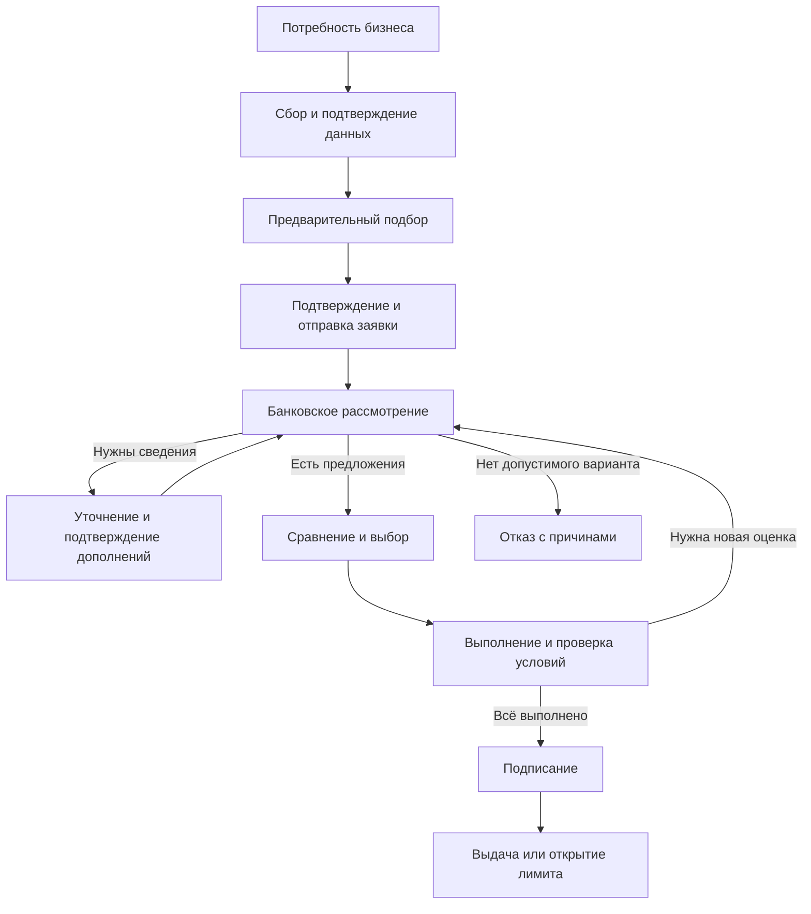

# Модель кредитного процесса и банковская обработка

## 1. Границы и участники процесса

Процесс начинается с потребности бизнеса в финансировании и заканчивается решением по заявке, а при выборе предложения — подписанием и выдачей денег или открытием лимита. В прототипе подписание и денежные операции моделируются.

**Предприниматель** сообщает и подтверждает сведения, отправляет заявку, отвечает на уточнения и выбирает предложение. **Ассистент** помогает пройти эти действия и понять результат. **Система** выполняет банковские проверки, расчёты и принимает решение по заданным правилам. Отдельного кабинета сотрудника банка нет.

## 2. Полный кредитный процесс — пункт 2 ТЗ

| Этап | Что происходит | Результат |
|---|---|---|
| **Потребность** | Выясняем цель, сумму, даты, регулярность расходов и приоритеты клиента | Понятная задача финансирования |
| **Сбор сведений** | Собираем профиль бизнеса и финансы через диалог, формы и документы; клиент подтверждает значения | Данные для подбора и рассмотрения |
| **Предварительный подбор** | Проверяем требования продуктов, считаем варианты и сравниваем их с задачей | Предварительные предложения |
| **Отправка** | Клиент проверяет итоговую форму и подтверждает отправку | Зафиксированная версия заявки |
| **Рассмотрение** | Проверяем данные, бизнес и обязательства, оцениваем риск, рассчитываем допустимые условия | Решение либо запрос уточнений |
| **Выбор** | Клиент сравнивает доступные варианты, их стоимость и требования | Выбранное предложение |
| **Выполнение условий** | Если нужны обеспечение или дополнительные подтверждения, клиент предоставляет их, система проверяет | Готовность к подписанию либо повторное рассмотрение |
| **Завершение** | Моделируем подписание и предусмотренную продуктом операцию | Выдача, погашение старых долгов при рефинансировании или открытие лимита |

Предварительный подбор помогает выбрать направление. Окончательные предложения появляются после рассмотрения отправленной заявки. Если нужны уточнения, процесс возвращается к сбору конкретных сведений, а не начинается заново.

### Какие данные используем

- **Запрос:** цель, сумма, срок, даты расходов, разовая или регулярная потребность, собственные средства, приоритеты.
- **Бизнес:** форма и возраст бизнеса, деятельность, регистрационные сведения.
- **Финансы:** поступления, расходы, налоги, остатки денег и действующие обязательства с указанием периодов.
- **Данные продукта:** для линии — выборки и погашения; для рефинансирования — закрываемые долги; для инвестиционного кредита — проект и обеспечение, если требуется.
- **Результаты рассмотрения:** внешние проверки, оценка риска, расчёты, причины и доступные предложения.

Подтверждённые сведения сохраняются. Обсуждение «а если взять меньше» создаёт отдельный расчёт. Отправленная заявка не меняется от разговора; подтверждённые дополнения создают новую версию для оценки.

## 3. Обработка со стороны банка — пункт 4 ТЗ

### 1. Проверка полноты и согласованности

Проверяем наличие необходимых сведений, периоды, единицы измерения и расхождения между ответами и документами. Если выручка указана без периода или суммы противоречат друг другу, запрашиваем уточнение. Неизвестное значение не считаем нулём.

### 2. Проверка бизнеса и обязательств

Получаем регистрационный статус, кредитную историю и сведения о долгах. В прототипе внешние источники воспроизводятся локальными симуляторами для подготовленных клиентов.

Общий запрет по правилам рассмотрения может исключить финансирование целиком. Несоответствие отдельному продукту исключает только этот продукт. Сбой внешней проверки переводит заявку в ожидание, а не в отказ.

### 3. Скоринг

Рассчитываем балльную оценку по кредитной истории, стабильности поступлений и зависимости от отдельных покупателей. По результату определяем класс риска. Для каждого продукта задано, какие классы допустимы и какие дополнительные условия нужны.

Скоринг — один из входов решения. Даже при подходящем классе риска запрашиваемая сумма может не проходить по платежам. Отсутствие кредитной истории отличается от хорошей истории; нехватка данных требует уточнения или сообщения об ограничении автоматической оценки.

### 4. Проверка способности погашать долг

Оцениваем деньги, остающиеся после операционных расходов и налогов, учитываем существующие обязательства и запас на текущую деятельность. При неравномерных поступлениях проверяем распределение денег по периодам.

| Продукт | Что проверяем |
|---|---|
| **Разовый и инвестиционный кредит** | Вписывается ли график платежей в доступные денежные потоки |
| **Овердрафт** | Какого размера временный дефицит и хватит ли поступлений погасить использованную сумму в установленный срок |
| **Возобновляемая линия** | Выборки, погашения, максимальную задолженность, проценты и закрытие долга к нужной дате |
| **Рефинансирование** | Новую нагрузку после закрытия выбранных долгов, комиссии и оставшуюся стоимость; остальные обязательства сохраняются |

Стоимость линии и овердрафта показываем для конкретного сценария использования. Для рефинансирования отдельно сравниваем платёж и общую оставшуюся стоимость: увеличение срока может снизить платёж, но увеличить выплаты.

### 5. Подбор допустимых условий

Сначала проверяем исходный запрос. Если он не подходит, ищем варианты:

1. Та же сумма на другом допустимом сроке.
2. Меньшая сумма или лимит.
3. Другой продукт под ту же задачу.
4. Предложение с дополнительными условиями, предусмотренными продуктом.

Каждый вариант проходит собственные проверки. Затем подходящие варианты сравниваются по задаче и приоритетам клиента: нужной сумме, платежам, сроку, стоимости и требованиям.

Меньшая сумма имеет смысл, если клиент может покрыть разницу или изменить объём задачи. Залог не отменяет проверку способности платить. Смена продукта не позволяет обойти общий запрет на финансирование.

### 6. Решение и следующее действие

| Результат | Когда возникает | Что происходит дальше |
|---|---|---|
| **Одобрение исходного запроса** | Запрошенные параметры прошли проверки | Клиент выбирает предложение и завершает оформление |
| **Другая сумма или срок** | Исходный вариант не проходит, альтернативный проходит | Клиент сравнивает изменённые условия |
| **Другой продукт** | Другая механика лучше соответствует задаче и допустима | Клиент видит отличия и выбирает |
| **Предложение с условиями** | Вариант требует конкретных дополнительных действий | Клиент выполняет условия; система проверяет их до подписания |
| **Уточнение информации** | Данных пока недостаточно для решения | Клиент дополняет сведения, система повторяет оценку |
| **Отказ** | Есть основание отказа либо нет допустимых вариантов | Показываем причины |

Запрос данных для оценки и предложение с условиями — разные ситуации. В первом случае решение ещё требует информации. Во втором уже определены параметры и требования, которые должны быть выполнены до завершения. Если новые сведения существенно меняют оценку, рассмотрение повторяется.

Клиент может отказаться от предложений и отменить заявку до подписания. В истории сохраняются этапы и причины результата. Для ситуации за пределами автоматических правил отдельно показываем ограничение оценки.

## 4. Где используется LLM

**Ассистент** понимает свободные сообщения и текст документов, уточняет неоднозначности, формулирует вопросы, объясняет продукты и готовые результаты. Например, превращает сообщение «не указан период выручки» в понятный вопрос клиенту.

**Система по правилам** определяет необходимые данные, выполняет внешние проверки, рассчитывает показатели и риск, проверяет продукты, подбирает условия и фиксирует решение. Статусы, числа и карточки предложения берутся из этих результатов.

## 5. Пример решения

Клиент просит миллион на год. После проверки расходов и действующих обязательств система определяет, что платёж по такому варианту превышает доступную нагрузку. При этом проходят два варианта: миллион на более долгий срок или меньшая сумма на год.

Клиент видит платежи и стоимость обоих предложений. Ассистент объясняет разницу и уточняет, хватит ли меньшей суммы. Клиенту нужен миллион целиком — он выбирает более долгий срок, подтверждает условия и завершает оформление.
