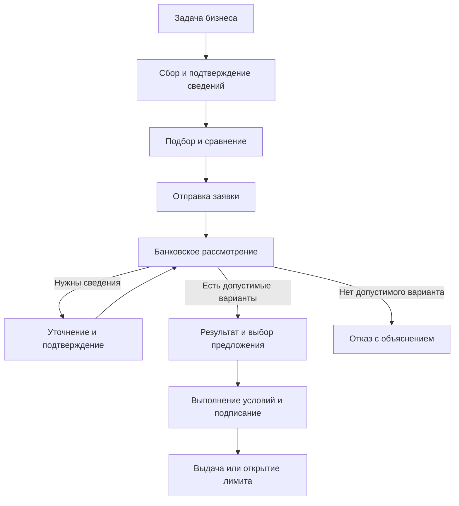

# Умный кредитный кабинет предпринимателя

## 1. Что мы делаем

Веб-кабинет для малого и микробизнеса, в котором предприниматель описывает свою задачу, подбирает финансирование и проходит весь путь от заявки до результата. ИИ-ассистент помогает разобраться в продуктах, собрать сведения и понять решение банка.

Кабинет объединяет чат, профиль бизнеса, документы, предложения и состояние заявки. Общаться можно свободным текстом, выбирать ответы в карточках или заполнять поля. Информация сохраняется между посещениями.

Главная идея: если исходный запрос не подходит, система ищет другой рабочий вариант — сумму, срок, условия или продукт — и объясняет разницу.

## 2. Какие задачи и продукты поддерживаем

| Задача предпринимателя | Продукт | Как он работает |
|---|---|---|
| Один раз закупить товар или сырьё | Разовый кредит на оборотные цели | Получить сумму и возвращать её по графику |
| Заплатить сейчас, пока ожидается ближайшее поступление | Овердрафт | Использовать деньги сверх собственного остатка на счёте в пределах лимита и погасить задолженность в установленный срок |
| Регулярно закупать товар небольшими партиями | Возобновляемая кредитная линия | Брать деньги частями в пределах лимита; погашение основного долга делает соответствующую сумму снова доступной |
| Купить оборудование, открыть новую точку, расширить производство | Инвестиционный кредит | Получить финансирование под конкретный проект с подходящим сроком и графиком |
| Изменить нагрузку по существующим кредитам | Рефинансирование | Погасить выбранные старые кредиты новым и сравнить платёж и оставшуюся стоимость до и после |

Для этих пяти продуктов предусматриваем полный путь оформления. Условия могут отличаться по сумме, сроку, ставке, комиссиям и необходимости залога или поручительства.

Ассистент также может объяснить дополнительные варианты: **факторинг** — получить деньги под оплату уже выполненной поставки; **лизинг** — получить имущество в пользование за платежи с предусмотренным договором выкупом; **банковская гарантия** — предоставить заказчику обязательство банка вместо денежного обеспечения. Их полное оформление в первую версию не входит.

## 3. Как клиент проходит весь процесс

### Шаг 1. Описывает задачу

Например: «Нужен миллион на закупку товара перед сезоном» или «Каждый месяц не хватает денег между оплатой поставщикам и поступлениями покупателей».

Ассистент уточняет цель, сумму, сроки, регулярность потребности, собственные средства и приоритеты. Важно понять не только сколько денег хочет клиент, но и когда они нужны и из чего будут возвращаться.

### Шаг 2. Собирает профиль бизнеса

Система постепенно запрашивает сведения о деятельности и возрасте бизнеса, поступлениях, расходах, действующих кредитах и остатках денег. Дополнительные вопросы зависят от продукта: для рефинансирования нужны старые кредиты, для линии — повторяющиеся закупки и поступления.

Клиент может загрузить документы. Ассистент извлекает сведения, показывает источник и предлагает подтвердить или исправить значения. Уже известные данные повторно не спрашиваются. Фактические показатели и ожидания от будущего проекта отображаются отдельно.

### Шаг 3. Сравнивает предварительные варианты

Система подбирает продукты под задачу и рассчитывает варианты. В карточке видны:

- сумма или лимит, срок и ставка;
- платежи, комиссии и общая стоимость либо стоимость выбранного сценария использования;
- требования и дополнительные условия;
- почему вариант подходит и чем отличается от других.

Клиент может спросить: «А если взять меньше?» или «Что изменится при сроке два года?». Появляется отдельный расчёт для сравнения. Он не меняет подтверждённые сведения сам по себе. Предварительный подбор ещё не является результатом банковского рассмотрения.

### Шаг 4. Подтверждает и отправляет заявку

Клиент видит итоговую форму, проверяет сведения и явно подтверждает отправку. После этого заявка поступает на рассмотрение, а в кабинете появляется история её движения.

### Шаг 5. Следит за рассмотрением и отвечает на уточнения

Система проверяет сведения, оценивает риск и рассчитывает допустимые условия. Клиент видит текущий этап. Если обнаружен пропуск или расхождение, получает конкретный вопрос или запрос документа, дополняет данные и подтверждает их для повторного рассмотрения.

### Шаг 6. Получает результат и выбирает предложение

Результат может сохранить исходный запрос или содержать альтернативы. Клиент видит причины изменения условий и сравнивает варианты. Если требуется залог или другое дополнительное условие, в кабинете указано, что именно необходимо выполнить.

### Шаг 7. Завершает оформление

После выбора предложения и выполнения условий клиент переходит к подписанию. В прототипе подписание и денежные операции моделируются внутри кабинета: для разового кредита показываем выдачу и график, для рефинансирования — погашение выбранных долгов, для овердрафта и линии — открытие лимита и пример его использования и погашения.

## 4. Как система принимает решение

**Проверяет данные.** Есть ли необходимые сведения, понятны ли периоды и нет ли противоречий. Например, выручку за квартал нельзя считать месячной. Если данных недостаточно, система уточняет их.

**Проверяет бизнес и обязательства.** Учитывает регистрационный статус, кредитную историю и существующие долги. В прототипе результаты внешних проверок воспроизводятся на подготовленных тестовых данных.

**Оценивает риск.** Использует балльные правила по кредитной истории, стабильности поступлений и зависимости от отдельных покупателей. Полученный класс риска учитывается вместе с требованиями продукта и возможностью погашать долг.

**Рассчитывает допустимое финансирование.** Учитывает деньги, остающиеся после расходов и налогов, действующие платежи и запас на текущую деятельность. Способ расчёта зависит от продукта:

- Для разового и инвестиционного кредита проверяется график платежей.
- Для овердрафта — размер временного дефицита и возможность погасить его в нужный срок.
- Для линии — график использования денег, поступлений, погашений и максимальная задолженность.
- Для рефинансирования — нагрузка после закрытия выбранных старых долгов, комиссии и оставшаяся стоимость.

**Проверяет исходный запрос и ищет альтернативы.** Сравнивает допустимые суммы, сроки, продукты и условия с задачей и предпочтениями клиента. Сначала исключает неподходящие варианты, затем выбирает наиболее полезные из оставшихся.

| Результат | Что видит клиент |
|---|---|
| Одобрение исходного запроса | Запрошенные сумма, срок и продукт |
| Другая сумма или срок | Новые условия, платежи и объяснение изменений |
| Другой продукт | Подходящая механика финансирования и её отличия |
| Предложение с условиями | Конкретные требования, которые нужно выполнить до завершения оформления |
| Нужны уточнения | Вопросы или документы, необходимые для продолжения |
| Отказ | Причина отсутствия допустимого предложения |

Меньшая сумма предлагается, если её хватает на задачу либо клиент может добавить свои деньги или уменьшить объём проекта. Увеличение срока сопровождается сравнением стоимости. Залог не заменяет проверку способности платить. Если ситуация выходит за возможности автоматической оценки, кабинет сообщает об этом отдельно; технический сбой проверки также не считается отказом.

### Роль ассистента

LLM понимает сообщения и документы, задаёт вопросы, находит сведения о продуктах и объясняет готовые результаты. Проверки, баллы риска, финансовые расчёты, подбор допустимых условий и само решение выполняются по правилам системы. Поэтому форма, карточки, расчёты и движение заявки не зависят от того, как модель сформулировала ответ.

## 5. Устройство и поведение кабинета

Основной вариант интерфейса — **«Форма и помощник»**:

- **Сверху:** текущий бизнес, доступ к своим заявкам, этапы и состояние текущей заявки, следующее действие.
- **В основной области слева:** потребность, данные бизнеса, документы, предложения и действия по текущему этапу.
- **Справа:** диалог с ассистентом; загрузка документа, подтверждение извлечённых полей и карточки предложений доступны прямо в диалоге.

На широком экране основная область занимает примерно две трети ширины, помощник — треть. На узком экране блоки располагаются последовательно. Данные бизнеса, документы, предложения и заявка — функциональные блоки одного процесса; обязательное переключение вкладок для действий не требуется.

Четыре правила интерфейса:

1. **Всегда видны состояние и следующее действие.** Показано, что заполнено, чего не хватает, что происходит сейчас и требуется ли участие клиента. После возвращения процесс продолжается с сохранённого места.
2. **Предварительный расчёт отличается от решения по заявке.** До отправки карточки помечены как предварительные. После рассмотрения отображаются результат, причины и доступные условия; изменение суммы, срока или продукта сопровождается объяснением.
3. **Извлечённые сведения подтверждает клиент.** Рядом со значениями видны источник и период, доступны исправление и подтверждение. Ассистент предлагает изменения; подтверждённые поля согласованно отображаются в форме и диалоге.
4. **«А если» создаёт отдельный сценарий.** Исходные параметры не изменяются при сравнении. Для применения есть отдельная кнопка «Применить к черновику». Отправленная версия неизменяема; подтверждённые дополнения создают новую версию для повторного рассмотрения.

Все действия доступны через обычные формы без ассистента. Отправка заявки, выбор предложения и подписание требуют явного действия клиента. Документы, уточнения, решение и завершение оформления остаются внутри кабинета; отдельный кабинет сотрудника банка не предусмотрен.

## 6. Пример целого сценария

Предприниматель просит **1 млн ₽ на закупку товара на год**. Ассистент собирает сведения, клиент подтверждает данные и отправляет заявку.

После проверок система определяет: платёж по исходному запросу превышает допустимую для этого бизнеса нагрузку. Она рассчитывает два подходящих варианта: **сохранить миллион, увеличив срок**, или **сохранить год, уменьшив сумму**.

Кабинет показывает платежи и стоимость обоих вариантов. Ассистент уточняет, хватит ли меньшей суммы на закупку. Клиент сообщает, что миллион нужен целиком, и выбирает более долгий срок. После подтверждения условий проходит демонстрационное подписание и видит результат выдачи с графиком платежей.

Так продукт помогает пройти от задачи бизнеса до подходящего решения и показывает, как это решение было получено.
