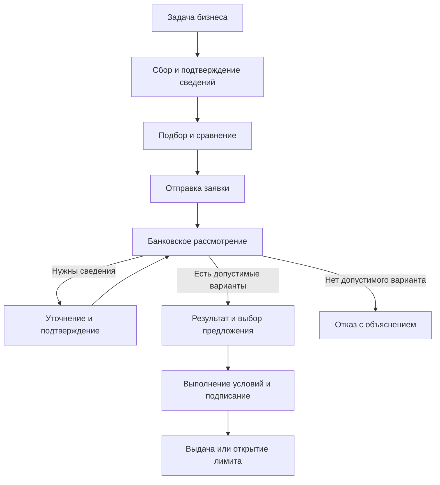

# Умный кредитный кабинет предпринимателя

## 1. Что мы делаем

Веб-кабинет для малого и микробизнеса, в котором предприниматель описывает свою задачу, подбирает финансирование и проходит весь путь от заявки до результата. ИИ-ассистент помогает разобраться в продуктах, собрать сведения и понять решение банка.

Лендинг содержит обзор возможностей, объяснение пути клиента, страницу проекта и документацию. Функциональный кабинет открывается по «Войти в кабинет». В демоверсии используется существующий синтетический клиент без отдельного входа по паролю.

В кабинете шесть разделов: **«Обзор»**, **«Данные бизнеса»**, **«Получить финансирование»**, **«Заявки»**, **«Моё финансирование»** и **«Платёжный календарь»**. Внутри получения финансирования доступны самостоятельный подбор и разговор с ИИ. У каждого способа свой черновик и сохранённый прогресс. Общими остаются банковский профиль, правила расчёта, действующие кредиты, заявки и платёжный календарь. Обзор показывает банковский остаток, ближайший платёж и заявки в работе; «Моё финансирование» объединяет кредиты из банковского профиля и полученные в кабинете продукты. Календарь позволяет выбрать все продукты либо один конкретный кредит/лимит.

Главная идея: если исходный запрос не подходит, система ищет другой рабочий вариант — сумму, срок, условия или продукт — и объясняет разницу.

## 2. Какие задачи и продукты поддерживаем

| Задача предпринимателя | Продукт | Как он работает |
|---|---|---|
| Один раз закупить товар или сырьё | Разовый кредит на оборотные цели | Получить сумму и возвращать её по графику |
| Заплатить сейчас, пока ожидается ближайшее поступление | Овердрафт | Использовать деньги сверх собственного остатка на счёте в пределах лимита и погасить задолженность в установленный срок |
| Объединить действующие кредиты или изменить нагрузку | Рефинансирование | Выбрать известные банку долги и заменить их одним кредитом; сравнить платёж и все оставшиеся выплаты |

Полный путь первой версии поддерживает эти три продукта. Возобновляемая линия и инвестиционный кредит остаются направлениями расширения. Сумма, срок и необходимость поручительства определяются правилами реализованного продукта.

Ассистент также может объяснить дополнительные варианты: **факторинг** — получить деньги под оплату уже выполненной поставки; **лизинг** — получить имущество в пользование за платежи с предусмотренным договором выкупом; **банковская гарантия** — предоставить заказчику обязательство банка вместо денежного обеспечения. Их полное оформление в первую версию не входит.

## 3. Как клиент проходит весь процесс

### Шаг 1. Описывает задачу

Например: «Нужен миллион на закупку товара перед сезоном» или «Каждый месяц не хватает денег между оплатой поставщикам и поступлениями покупателей».

Самостоятельный путь состоит из трёх шагов: «На что нужны деньги» → «Подходящие предложения» → «Проверка и отправка». Клиент выбирает задачу или продукт, а система показывает только нужные поля и уточнения. Даты и суммы предстоящих платежей и поступлений уточняются внутри первого шага, когда нужны для задачи; отдельного шага «Денежный план» нет. В режиме с ассистентом он описывает задачу обычным языком и отвечает текстом либо готовыми ответами в карточках. Важно понять не только сколько денег хочет клиент, но и когда они нужны и из чего будут возвращаться. Известные сведения повторно не запрашиваются.

### Шаг 2. Использует готовый профиль бизнеса

Клиент уже обслуживается в банке. Сведения о компании, остаток на счёте, история операций и действующие кредиты поступают из банковского профиля, кредитная история — из проверки. В прототипе эти источники смоделированы. Известные показатели показаны для просмотра; заполнять их заново и загружать таблицу не требуется. Клиент дополняет только отсутствующие сведения.

Для овердрафта указывает сумму и дату ближайшего расхода, сумму и дату ожидаемого поступления. Дополнительные операции добавляются по необходимости. Остаток подставляется из профиля, период определяется по датам операций. Запас денег и ручная настройка периода доступны отдельно. Суммы платежей по действующим кредитам также подставляются из профиля; клиент уточняет даты и подтверждает полноту плана. В разговорном режиме названные суммы и даты сразу появляются в рабочей области, обновляя временную линию и предварительный денежный план. Предложенные значения отмечены и доступны для исправления. Прогноз не заменяет фактическую историю.

### Шаг 3. Сравнивает предварительные варианты

Готовые предложения показаны сразу после расчёта; дополнительные настройки расположены ниже. Для получения вариантов не нужно самостоятельно придумывать альтернативы.

Система подбирает продукты под задачу и рассчитывает варианты. В карточке видны:

- сумма или лимит, срок и ставка;
- платежи, комиссии и общая стоимость либо стоимость выбранного сценария использования;
- требования и дополнительные условия;
- почему вариант подходит и чем отличается от других.

Для кредита клиент видит несколько допустимых сроков, сравнивает платёж, стоимость, условия и график. Может ограничить комфортный платёж, изменить сумму отдельного расчёта или попросить ассистента показать варианты. Меньшие суммы доступны только при подтверждённом минимуме. Расчёты сохраняются отдельно; выбор условий требует подтверждения.

Для овердрафта показан денежный план по дням: остаток без финансирования, использование лимита, проценты и погашение. Можно проверить перенос конкретного поступления. Если дата выходит за период плана, система просит дополнить период. При неизвестном лимите предлагает рассчитанную потребность для проверки и подтверждения.

### Шаг 4. Подтверждает и отправляет заявку

После выбора условий клиент переходит к оформлению: автоматически собранный черновик доступен в разделе «Заявки». Он проверяет сведения, видит недостающие поля и документы и явно подтверждает отправку. Только после этого заявка поступает на банковское рассмотрение.

### Шаг 5. Следит за рассмотрением и отвечает на уточнения

Система проверяет сведения, оценивает риск и рассчитывает допустимые условия. Клиент видит текущий этап. Если обнаружен пропуск или расхождение, получает конкретный вопрос или запрос документа, дополняет данные и подтверждает их для повторного рассмотрения.

### Шаг 6. Получает результат и выбирает предложение

Результат может сохранить исходный запрос или содержать альтернативы. Клиент видит причины изменения условий и сравнивает варианты. Если требуется залог или другое дополнительное условие, в кабинете указано, что именно необходимо выполнить.

### Шаг 7. Завершает оформление

После выбора предложения и выполнения условий клиент переходит к подписанию. В прототипе подписание и денежные операции моделируются внутри кабинета: для разового кредита показываем выдачу и график, для овердрафта — открытие лимита; использование и погашение видны в расчётном плане.

## 4. Как система принимает решение

**Проверяет данные.** Есть ли необходимые сведения, понятны ли периоды и нет ли противоречий. Например, выручку за квартал нельзя считать месячной. Если данных недостаточно, система уточняет их.

**Проверяет бизнес и обязательства.** Учитывает регистрационный статус, кредитную историю и существующие долги. В прототипе результаты внешних проверок воспроизводятся на подготовленных тестовых данных.

**Оценивает риск.** Использует балльные правила по кредитной истории, стабильности поступлений и зависимости от отдельных покупателей. Полученный класс риска учитывается вместе с требованиями продукта и возможностью погашать долг.

**Рассчитывает допустимое финансирование.** Учитывает деньги, остающиеся после расходов и налогов, действующие платежи и запас на текущую деятельность. Способ расчёта зависит от продукта:

- Для разового кредита проверяется график платежей.
- Для овердрафта — размер временного дефицита и возможность погасить его в нужный срок.
- Для рефинансирования — новый платёж после замены выбранных долгов; отдельно сравниваются платёж и все оставшиеся выплаты. Увеличение срока не выдаётся за экономию.

**Проверяет исходный запрос и ищет альтернативы.** Сравнивает допустимые суммы, сроки, продукты и условия с задачей и предпочтениями клиента. Сначала исключает неподходящие варианты, затем выбирает наиболее полезные из оставшихся.

| Результат | Что видит клиент |
|---|---|
| Одобрение исходного запроса | Запрошенные сумма, срок и продукт |
| Другая сумма или срок | Новые условия, платежи и объяснение изменений |
| Другой продукт | Подходящая механика финансирования и её отличия |
| Предложение с условиями | Конкретные требования, которые нужно выполнить до завершения оформления |
| Нужны уточнения | Вопросы или документы, необходимые для продолжения |
| Отказ | Причина отсутствия допустимого предложения |

Меньшая сумма предлагается, если её хватает на задачу либо клиент может добавить свои деньги или уменьшить объём проекта. Увеличение срока сопровождается сравнением стоимости. Залог не заменяет проверку способности платить. Если ситуация выходит за возможности автоматической оценки, кабинет сообщает об этом отдельно; технический сбой проверки также не считается отказом.

### Роль ассистента

LLM понимает сообщения, задаёт вопросы, предлагает изменения потребности, запускает сравнение условий кредита и объясняет готовые результаты. Проверки, баллы риска, финансовые расчёты, подбор допустимых условий и само решение выполняются по правилам системы. Поэтому форма, карточки, расчёты и движение заявки не зависят от того, как модель сформулировала ответ.

## 5. Устройство и поведение кабинета

### Два способа подбора

**«Подобрать продукт».** Полный самостоятельный путь без LLM: задача или каталог → короткие контекстные поля → уточнения → расчёт и сравнение → выбор условий. Система сама проверяет полноту данных, правила продуктов и возможность погашения. Известные банку сведения уже подставлены; огромной анкеты на первом экране нет.

**«С ИИ-ассистентом».** Диалог и живая рабочая область. Сначала показаны текущая задача и состояние, например «Уточняем потребность». По мере разговора появляются и заполняются нужные поля, линия поступлений и выплат, график остатков и предложения. Новые значения получают краткую подсветку и источник. Карточки в разговоре служат для коротких уточнений, а редактирование происходит в самой рабочей области. Отдельной копии анкеты внутри чата нет.

Черновики двух путей независимы: ручной ввод не попадает в разговор с ассистентом, а сведения из разговора не меняют самостоятельный подбор. Каждый раздел восстанавливает собственный прогресс. Оба используют одни правила расчёта. Недоступность модели не мешает самостоятельному пути. Переход в «Заявки» выполняется после выбора условий и действия «Перейти к оформлению»; сам по себе разговор не отправляет заявку в банк.

### Функции целевого MVP

| Функция | Как это работает для клиента |
|---|---|
| Уточнения в карточках | Нажать готовый ответ или написать свой; спрашиваем только недостающее |
| Живая рабочая область | Сведения из разговора появляются в полях, события — на временной линии, результаты — в карточках сравнения |
| Счёт на предстоящую оплату | Необязательно загрузить текстовый PDF-счёт поставщика: сумма и дата становятся будущим расходом после проверки. У полей виден источник. Нехватку рассчитываем с учётом банковского остатка и других операций; сумму счёта не подставляем в сумму кредита |
| Проверка противоречий | Разные суммы или даты из разговора, документа и профиля не перезаписываются молча: показаны источники и конкретный вопрос |
| Подбор продуктов | Учитываются задача, показатели бизнеса и условия продуктов; видны причины выбора, ограничения и недостающие сведения |
| Сравнение условий | Сумма к получению, сроки, платежи, проценты, комиссии, обеспечение или поручительство при наличии; различия объясняются с учётом приоритета клиента |
| Денежный план | По датам показаны поступления, расходы, дефицит и остаток с финансированием и без него, включая проценты и погашение |
| Проверка изменения ситуации | Дополнительно проверить задержку конкретного поступления: исходный и изменённый денежные планы показаны рядом. Основной результат подбора — несколько готовых предложений, без необходимости задавать вопросы «а если». Изменения применяются отдельно |
| Объяснения по ходу дела | Вопрос о продукте, платеже или условии не сбрасывает текущий шаг |
| Собранная заявка | Подтверждённые сведения подставлены; видны недостающие поля и документы, перед отправкой доступна общая проверка |
| Сопровождение | В разделе «Заявки» видны этап, запрос банка, решение, условия и следующее действие. При отсутствии банковского API используется обозначенный симулятор |
| Сохранение и качество интерфейса | Сохраняются диалог, данные, выбранный сценарий и заявка; на мобильном доступны те же действия, загрузки, повтор запроса и понятные ошибки |

### Платёжный календарь и следующие кредиты

В календаре месяца показаны платежи по всем полученным кредитам. К ним можно добавить поступления и расходы одного выбранного плана; в деталях дня видны сумма, источник и отметка ожидаемого события. На телефоне события показаны списком по датам. Последний платёж обозначен по графику: наступление даты само по себе не означает исполнение платежа.

После демонстрационной выдачи кредит становится обязательством клиента, а выданная сумма поступает на счёт. Его платёж учитывается при подборе и рассмотрении следующей заявки. Ранее открытые черновики получают обновлённые банковские данные и требуют пересчёта; подписать предложение по старой нагрузке нельзя. Известные банку платежи добавляются к будущим расходам один раз. Открытый лимит овердрафта не приравнивается к использованному долгу; выборки и погашение в календаре остаются прогнозом по плану.

### Подтверждения и движение интерфейса

Рефинансирование направляет деньги на погашение выбранных кредитов, без дополнительной выдачи на счёт. После завершения старые долги остаются в истории, их будущие платежи заменяются новым графиком. При следующем обращении учитывается только действующая нагрузка. Выбор обязательств и сравнение доступны без LLM.

Данные из разговора и документов сразу видны как **предложенные значения рабочего черновика**. Рядом доступны источник и исправление. Для обновления отображения не требуется после каждого сообщения отдельно сохранять карточку и применять её к форме. Неоднозначные и противоречивые значения уточняются; банковские факты не заменяются словами ассистента.

Предварительный расчёт по рабочему сценарию обновляет визуализацию и не является кредитным решением. Подтверждение выбранных данных и условий, применение варианта «а если» и отправка заявки — явные действия. Отправленная версия остаётся неизменной.

Анимации показывают, какое поле заполнилось и что изменилось в графике. Статусы соответствуют реальным действиям: «Уточняем данные», «Рассчитываем варианты», «Готово к оформлению». Декоративное ожидание не задерживает результат. На мобильном диалог и рабочая область доступны в одном сценарии без прокрутки длинной анкеты; при уменьшении анимаций в настройках устройства переходы упрощаются.

Подробности полей и движения описаны в [спецификации формы](technical/CLIENT_FORM.md), предложения и рассмотрение — в [пути клиента](technical/CLIENT_JOURNEY.md).

## 6. Пример целого сценария

Предприниматель просит **1 млн ₽ на закупку товара на год**. Ассистент собирает сведения, клиент подтверждает данные и отправляет заявку.

После проверок система определяет: платёж по исходному запросу превышает допустимую для этого бизнеса нагрузку. Она рассчитывает два подходящих варианта: **сохранить миллион, увеличив срок**, или **сохранить год, уменьшив сумму**.

Кабинет показывает платежи и стоимость обоих вариантов. Ассистент уточняет, хватит ли меньшей суммы на закупку. Клиент сообщает, что миллион нужен целиком, и выбирает более долгий срок. После подтверждения условий проходит демонстрационное подписание и видит результат выдачи с графиком платежей.

Так продукт помогает пройти от задачи бизнеса до подходящего решения и показывает, как это решение было получено.
