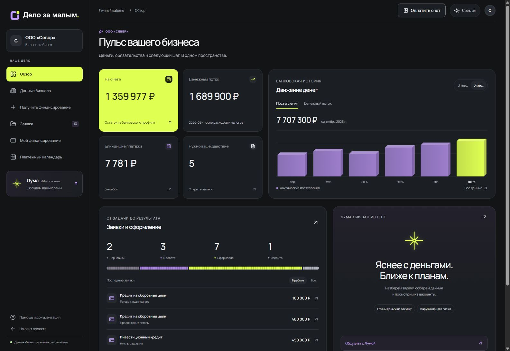
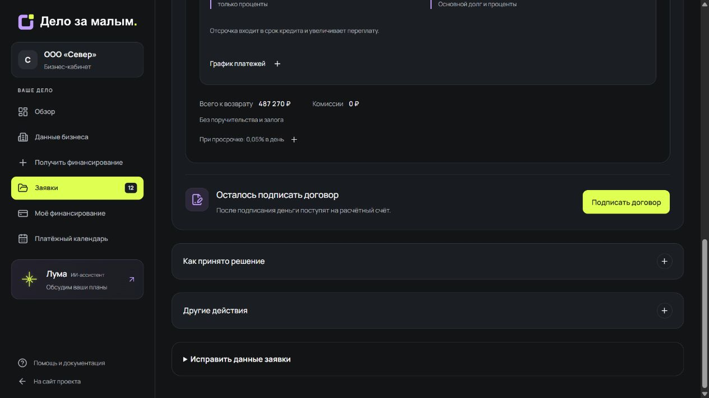
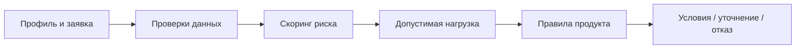

# Решение для предпринимателя и банка

**Дело за малым** связывает потребность бизнеса, рассмотрение заявки и обслуживание финансирования в одном кабинете. Клиент видит следующий шаг, а каждое решение опирается на сохранённые данные и правила продукта.

## Что мы изучили и как это повлияло на продукт

Основание: ТЗ, разбор кредитного процесса, синтетические финансовые сценарии и проверки интерфейса. Интервью с предпринимателями и измеренное улучшение бизнес-метрик пока не проводились; ниже — выводы анализа и проверенные механики MVP.

| Наблюдение | Продуктовое решение | Что можно проверить |
|---|---|---|
| Пользователь описывает задачу бизнеса, а не название кредита | Вход через закупку, ожидание выручки, регулярное финансирование, развитие или рефинансирование | Пошаговый подбор и разные требования пяти продуктов |
| Повторный ввод известных банку сведений мешает пройти заявку | Профиль компании и обязательства уже заполнены; уточняются потребность и недостающие сведения | «Данные бизнеса» и форма заявки |
| Свободный разговор удобен, но не должен незаметно менять обязательства | Лума собирает данные в соседней форме; изменения подтверждает пользователь | Диалог, обновление полей и отдельное подтверждение |
| Высокий скоринговый балл не гарантирует доступность любой суммы | Риск, доступная нагрузка и продуктовые ограничения рассчитываются отдельно | «Как принято решение»; одинаковый риск при разных суммах и сроках |
| Средний положительный поток может скрывать сезонный провал | Сохраняются отрицательные месяцы, проверяется консервативный денежный поток | История бизнеса, расчёт нагрузки, прогноз остатка |
| Выдача кредита — начало обслуживания, а не конец задачи клиента | После оформления обновляются долг, счёт, календарь и следующие расчёты | «Моё финансирование», погашение, таймлайн и прогноз |

## Пять продуктов — разная бизнес-логика

- **Оборотный кредит:** одна сумма, график и досрочное погашение.
- **Овердрафт:** подключённый лимит покрывает нехватку при оплате; поступления уменьшают долг. Проценты начисляются на использованную сумму.
- **Кредитная линия:** деньги выбираются частями; погашение восстанавливает доступный лимит.
- **Рефинансирование:** погашаются выбранные обязательства, создаётся новый график без двойного долга.
- **Инвестиционный кредит:** стоимость проекта, собственный взнос и отсрочка основного долга проверяются вместе.

## Почему решение можно объяснить

Балльный скоринг учитывает кредитную историю, стабильность поступлений и концентрацию покупателей. Он отделён от расчёта платежа и итогового решения. В заявке сохранена трасса конкретного расчёта, а не объяснение, придуманное моделью. [Формулы и веса](technical/SCORING.md), [расчёт нагрузки](technical/FINANCIAL_METRICS.md).

## Что подтверждено

- Основной кредитный путь, все пять продуктов, уточнения и операции проверяются автоматизированными сценариями с отдельными базами.
- Есть проверка запуска из чистого клона со снимком кабинета и реальным ответом Dahl. [Результаты и команды](CHECKS.md).
- Лума проверялась на 20 сценариях по три повтора: 60/60. [Набор сценариев](../contracts/evals/luma-regression-cases.json) и [порядок повторной проверки](CHECKS.md) доступны в репозитории. Это техническая приёмка, а не исследование пользовательской конверсии.
- Ввод данных, выбор предложения, отправка, подписание и денежные операции разделены; ответ LLM не может сам выдать кредит.

## Границы MVP

Все данные синтетические. Банковские проверки, подпись и переводы смоделированы. Каталог и скоринговые пороги демонстрационные; это не тарифы и не промышленная модель банка. Нет промышленной авторизации, разграничения банковских ролей и высокой доступности. Следующие шаги: проверка сценариев с предпринимателями, калибровка правил на разрешённых данных, роли и аудит доступа, реальные интеграции.

[Запуск и сценарий проверки](../README.md#быстрый-запуск) · [Полная документация](README.md) · [Соответствие ТЗ](SUBMISSION.md)
