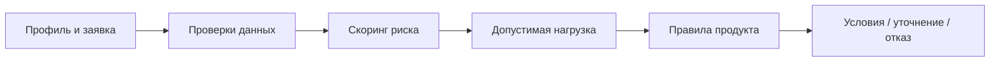

# Кредитный кабинет предпринимателя

**Дело за малым** объединяет подбор финансирования, рассмотрение заявки и обслуживание кредитов. Предприниматель начинает с задачи бизнеса, сравнивает условия и после оформления видит обязательства вместе с деньгами на счёте.

## От задачи к продукту

| Задача | Как работает кабинет |
|---|---|
| Закупить товар или сырьё | Подбирает разовый кредит с понятным графиком возврата |
| Оплатить расходы до поступления выручки | Рассчитывает кассовый разрыв и подходящий овердрафт |
| Финансировать регулярные закупки | Предлагает возобновляемую линию с выборками частями |
| Купить оборудование или открыть новую точку | Учитывает стоимость проекта, собственный взнос и отсрочку основного долга |
| Объединить действующие кредиты | Сравнивает текущие обязательства с новым графиком рефинансирования |

Профиль компании, банковская история и действующие обязательства уже доступны в кабинете. Клиент уточняет сумму, сроки и сведения, необходимые для своей задачи. Запрос можно заполнить пошагово или обсудить с Лумой: данные из разговора появляются в форме рядом с перепиской и применяются после подтверждения.

## Выводы анализа и продуктовые решения

В основе интерфейса — разбор кредитного пути и финансовых сценариев малого бизнеса.

| Вывод | Решение в продукте | Польза предпринимателю |
|---|---|---|
| Задача бизнеса понятнее названия банковского продукта | Вход через закупку, ожидание выручки, развитие или рефинансирование | Можно начать с потребности, не изучая весь каталог |
| Значительная часть сведений уже известна банку | Заполненный профиль и запрос только недостающих данных | Меньше повторного ввода |
| Средний положительный поток может скрывать убыточный месяц | Учёт сезонности, обязательств и консервативного денежного потока | Условия сопоставляются с возможностью платить, а не только с оборотом |
| Разговор может менять параметры незаметно для клиента | Форма обновляется рядом с перепиской; изменения подтверждаются отдельно | Видно, что войдёт в заявку |
| После выдачи кредита обязательства остаются частью ежедневной работы | Счёт, продукты, календарь и прогноз остатка связаны | Можно заранее увидеть платежи и возможную нехватку денег |

## Проверки и решение

Скоринг учитывает кредитную историю, стабильность поступлений и концентрацию покупателей. Доступный платёж рассчитывается отдельно: из денежного потока вычитаются расходы, налоги и текущие обязательства. Сезонные провалы и отрицательные месяцы учитываются при оценке нагрузки.

Каждый вариант проверяется по ограничениям своего продукта. Если запрос не проходит, кабинет может предложить другой срок или сумму, запросить сведения либо показать причину отказа. В заявке доступны история проверок и исходные данные расчёта. [Скоринг](technical/SCORING.md), [финансовые показатели](technical/FINANCIAL_METRICS.md), [правила решения](technical/ASSESSMENT.md).

## После оформления

- **Кредиты:** остаток основного долга, начисленные проценты, график и досрочное погашение.
- **Овердрафт:** подключённый лимит покрывает нехватку при оплате; поступления уменьшают использованный долг.
- **Кредитная линия:** деньги выбираются частями, погашение восстанавливает доступный лимит.
- **Рефинансирование:** прежние обязательства погашаются, платежи переходят в новый график.
- **Расчётный счёт:** оплата поставщику по реквизитам, загрузка данных из текстового PDF и история операций.
- **Календарь и таймлайн:** поступления, списания, кредитные платежи, прогноз остатка по дням и расчёт пеней.

Лума помогает собрать запрос и объяснить условия. Скоринг, ставки и банковское решение определяет кредитный модуль. Отправку заявки, подписание и денежные операции подтверждает клиент.

## Демонстрационная версия

В кабинете используется синтетическая компания ООО «Север». Банковские проверки, подпись и переводы смоделированы. Тарифы и скоринговые пороги заданы правилами прототипа. Промышленная авторизация и разграничение банковских ролей в эту версию не входят.

[Запуск](../README.md#быстрый-запуск) · [Демонстрационный кабинет](DEMO.md) · [Документация](README.md)
