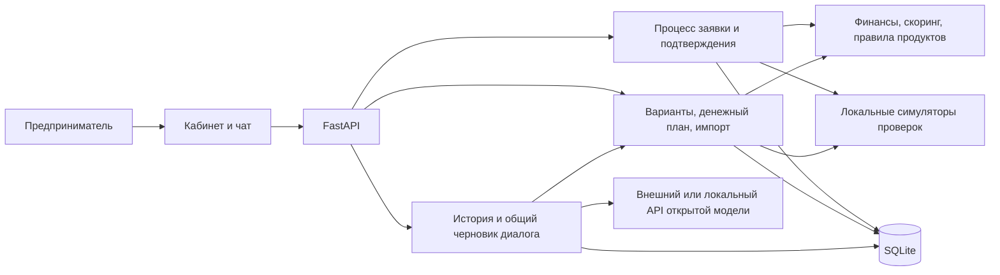
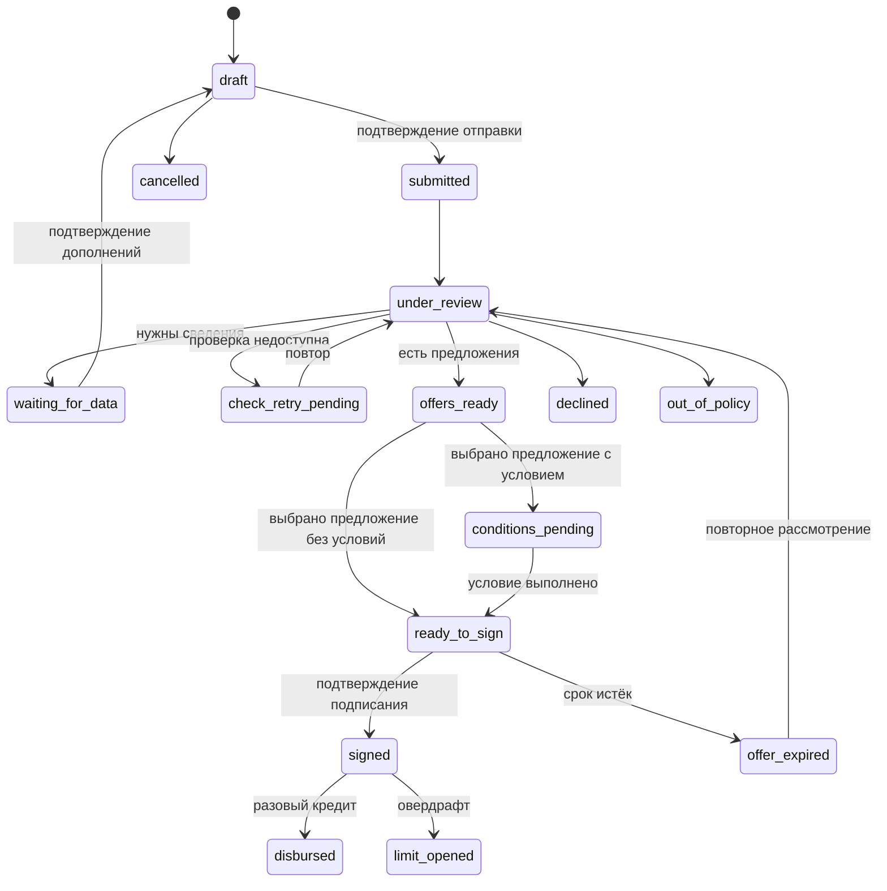
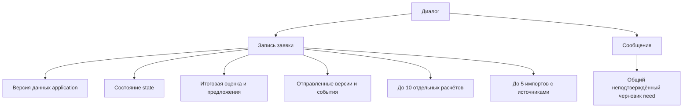

# Устройство приложения

FastAPI отдаёт встроенный веб-интерфейс и API. Модель подключается переменными окружения: локальный сервер или внешний OpenAI-совместимый API; кабинет и оформление работают без неё. Расчёты выполняет Python-модуль `credit_engine`. Статусы и денежные операции не устанавливаются ответом модели.

## Состояния заявки

Рассмотрение выполняется синхронно: промежуточные этапы записываются в событиях в одной транзакции. Интерфейс показывает историю фактических этапов. Изменение данных после рассмотрения возвращает заявку в черновик с новой версией; отправленные версии остаются неизменными.

## Данные

Физическое хранение — четыре таблицы SQLite:

| Таблица | Ключ | Содержимое |
|---|---|---|
| `applications` | `application_id` | JSON записи заявки и `updated_at` |
| `chats` | `chat_id` | JSON диалога, включая ссылку на `application_id` |
| `documents` | `document_id` | PDF BLOB и связь с заявкой |
| `account_payments` | `request_id` | JSON подтверждённой оплаты и источников средств |

В записи заявки находятся `application`, `state`, `checks`, `result`, `recommendation`, `readiness`, `signature`, `completion`, `events`, `submitted_versions`, `explorations`, `imports`. Результаты симулятора хранятся отдельно от редактируемых клиентом данных.

Изменения защищены `application_version` и `chat_version`. При подтверждении диалога дополнительно сравниваются исходные значения конкретных полей: независимые правки объединяются, конфликтующие требуют проверки. Заявка и подтверждение карточки сохраняются атомарно.

SQLite использует WAL и транзакции записи `BEGIN IMMEDIATE`. Ожидание LLM происходит вне блокировки базы. Повтор сообщения с тем же `request_id` не создаёт дублей. Предварительные расчёты и CSV не меняют заявку без подтверждения; перед подписанием проверяются итоговая оценка, версия, выбранное предложение, срок и условия.

API описан в `openapi.json` и `/docs`; коллекция запросов — `contracts/credit_process.postman_collection.json`. Проверки: `uv run --frozen python -m unittest discover -s tests` и `python -m scripts.run_api_scenarios`.

В стендовом запуске Caddy принимает HTTP/HTTPS и передаёт запросы FastAPI по внутренней Docker-сети. API модели вызывается только backend; ключ не попадает в браузер или образ. Настройки провайдера заменяются без изменения кода. `compose.stand.yaml` ограничивает память API и прокси, а LLM работает за пределами VPS с 4 ГБ. Одновременно выполняются до двух генераций; остальные запросы получают понятный отказ ожидания без блокировки форм. См. [развёртывание](DEPLOYMENT.md).
