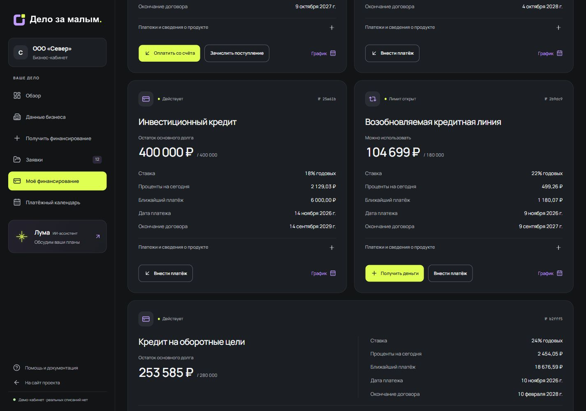
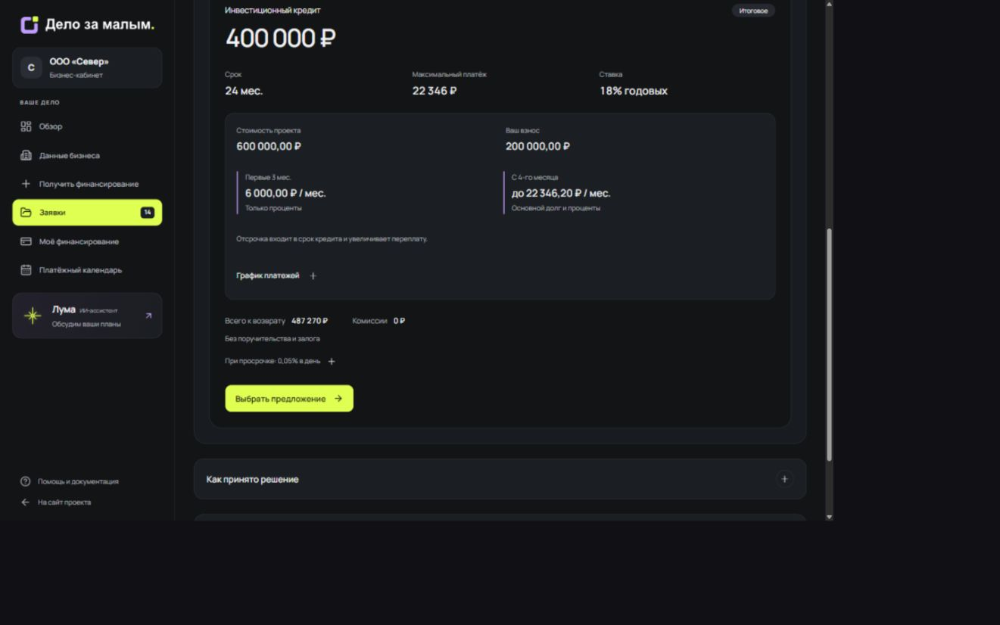
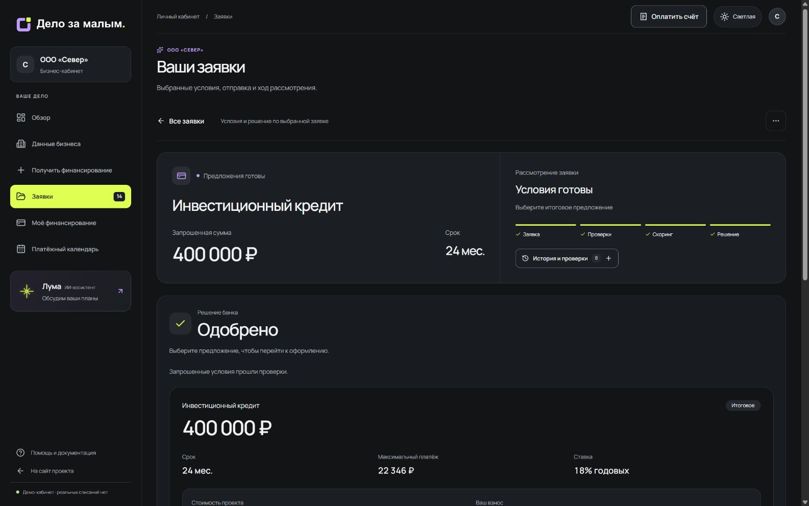

# Application decisions and compact portfolio cards

## Changes

- Completed review stages use the brand completion colour and a check mark. Waiting stages remain neutral; existing state logic and the saved decision trace are preserved.
- The final assessment outcome is the main heading, including distinct conditional approval. Preliminary calculations are not labelled as bank approval.
- Offer cards start with product and amount, followed by term, payment and rate. Investment cost/contribution and the two payment phases are grouped separately.
- Penalty terms are a compact disclosure with their source and calculation basis retained. The schedule is still available as a table; selecting/signing behavior is unchanged.
- Portfolio cards no longer reserve two lines for titles or stretch the space above facts. Full product names are preserved. The amount denominator is a smaller, muted number only, with its meaning available to assistive technology.
- Three upcoming payments, limit utilization and product explanations remain available through a disclosure rather than expanding every card by default.

## Verification

- 13 targeted tests passed. Full frontend run with `--maxWorkers=2`: **158 passed, 20 integration tests skipped**. A preceding unrestricted run launched 50 workers and timed out one calendar test; the full bounded-worker run passed without selecting or excluding cases. Six portfolio tests passed again after the final caption change.
- Production build and lint passed; existing chunk-size and Fast Refresh warnings remain.
- Browser: real approved investment application on port 18000 shows all four completed stages, prominent approval, 24 schedule rows and expandable penalty terms. No financial action performed.
- Browser: portfolio on port 18007, 1440 × 1000: first four cards have equal heights within each row (517.34 px), actions align, title-to-balance gap is 16 px; full names remain intact.
- Browser: 390 × 844 portfolio and decision views have no horizontal overflow. Investment phase columns stack. Light theme uses the existing purple brand completion token, dark theme uses lime.
- Upcoming payments still show actual schedule amounts (6,000 / 6,000 / 15,456.58 for the investment example) and the principal grace explanation when expanded.
- Both local frontends updated; no database reset, seed or account/application write.

