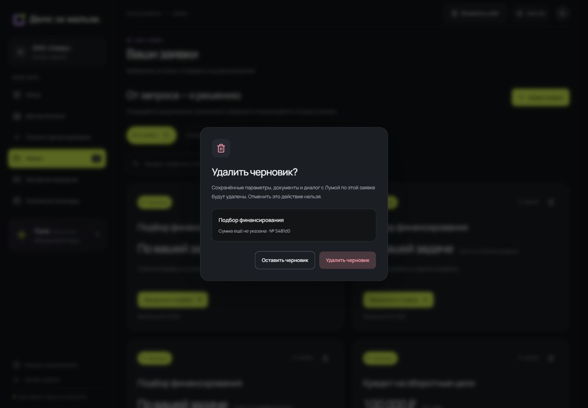
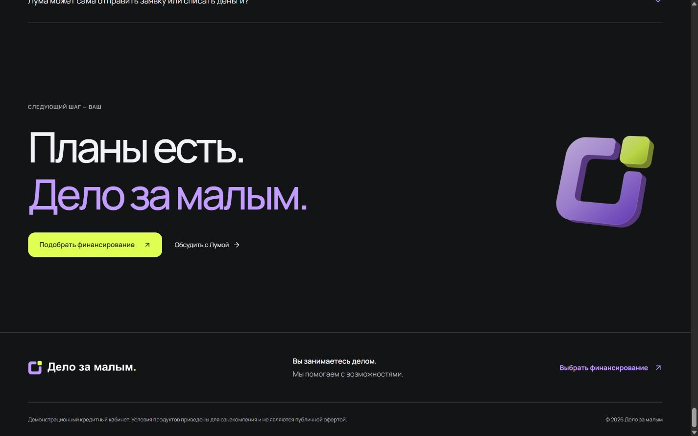
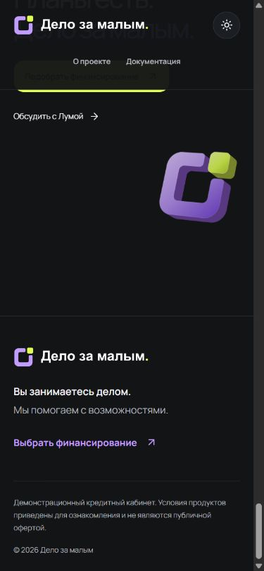

# Draft deletion and restrained final landing artwork

## Drafts

- Draft cards have a visible trash action; an opened draft has the same action in its toolbar.
- The confirmation identifies the draft and explains that parameters, documents and the linked Luma dialogue will be deleted.
- `DELETE /api/applications/{id}` requires `confirmed: true` and the current application version. The service checks draft status and rejects signed/completed records, including a state change made in another tab.
- Application, chats and document blobs are deleted in one SQLite transaction. Existing financing and account payments are untouched.
- The client removes stale form/chat storage, cache and active selection bindings, refreshes counts/calendar plans, and returns an opened deleted draft to the list.
- Requests and late model responses cannot recreate the deleted record. Document uploads and chat creation also check that the application still exists.
- Public documentation describes the action and API.

## Landing

- Reused the actual brand symbol geometry as a shallow SVG/CSS sculpture; no raster backdrop, hand or glowing panel.
- After user feedback, reduced it to a 260 px decorative accent on desktop (190 px at intermediate widths; 140 px on mobile), with 0.82 opacity.
- One-time eased entry lasts 1.15 s; the ambient loop moves only 3 px over 12 s and pauses outside the viewport or when the page is hidden. Scrolling back does not replay the exit.
- Headline and calls to action retain priority. Existing page scroll pacing was not changed.

## Validation

- Backend full run: **516 tests run, 515 passed, one platform-specific skip**. Includes version/confirmation guards, child record isolation, refusal to delete issued/submitted records, and an in-flight model response during deletion.
- Frontend full run: **160 passed, 20 integration tests skipped** (`--maxWorkers=2`). New tests cover confirmation/cancellation, draft-only visibility, and cleanup of one draft's saved fields without affecting another.
- Production build and lint passed; existing bundle-size and Fast Refresh warnings remain.
- Browser: draft action and confirmation verified on port 18007; test opening was cancelled. No existing user draft was deleted during browser QA.
- Browser: final accent 260 px at 1440 × 900, 140 px at 390 × 844; no horizontal overflow and both calls to action remain visible.
- Local ports 18000 and 18007 updated without database reset or reseeding.

