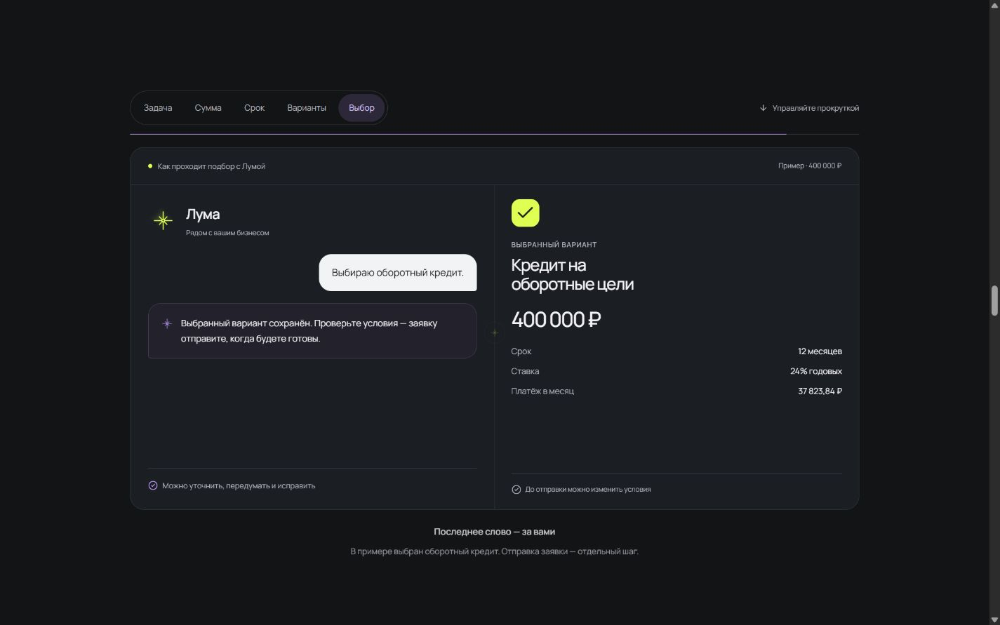

# Темп лендинга — 25 октября 2026

Исправлены две независимые проблемы: медленная прокрутка страницы и короткое время чтения сцен Лумы. Применены Motion Design и GSAP ScrollTrigger.

## Изменения

- Обычное колесо на 120 px теперь перемещает страницу примерно на 126 px, вместо 81 px. Потолок непрерывного движения поднят с 540 до 1350 px/с; сглаживание сокращено со 100 до 75 мс. Ограничены отдельные скачки и накопление инерции, смена направления сразу сбрасывает старую цель.
- Исправлена обработка асинхронного scroll-события: собственное движение сравнивается с последней записанной позицией, а не с ещё не достигнутой целью. Иначе увеличенная скорость могла бы сама себя отменять.
- Каждый этап Лумы занимает восемь единиц GSAP вместо четырёх. Большая часть этапа теперь отведена полностью видимому тексту; длительность переходов не растягивается на весь этап. Сами значения duration в scrub-сцене задают долю пути прокрутки, а не фиксированные секунды.
- В окне 1440 × 900 высота сцены Лумы увеличена с 2880 до 6750 px. Путь анимации — с 1980 до 5850 px: около 1170 px на этап вместо 396 px. Полная видимость ответа сохраняется примерно 790 px вместо 139 px.
- У продуктов пропорционально увеличен путь показа, чтобы ускорение колеса не сократило время знакомства с каждым продуктом. Разметку по-прежнему удерживает CSS sticky; при выходе не удаляются spacer-элементы.
- На узком экране остаётся ручное переключение этапов.

## Проверка в браузере

В сцене «Сумма» после выбора этапа и трёх последовательных прокруток по 0,25 страницы:

| Позиция scrollY | Этап | Непрозрачность ответа |
| ---: | ---: | ---: |
| 4665,33 | 1 | 1 |
| 4840,00 | 1 | 1 |
| 5018,67 | 1 | 1 |
| 5198,00 | 1 | 1 |

В последнем этапе ответ и условия имели opacity=1 и до, и после следующего движения колеса. Выход из сцены проверен пятью последовательными движениями: календарь приближался постепенно, с top=1380,85 до top=656,85, без пропуска секции (`scene-exit.json`).

На экране 1366 × 650 вся карточка занимает диапазон y=126,17…631,17; ответ и условия полностью помещаются в окно. На 390 × 844 активен ручной режим, горизонтального переполнения нет.

Проверена новая версия на localhost:18007. Обновлены локальные контейнеры 18000 и 18007. Дополнительно обнаружена старая открытая вкладка пользователя: она работала с `index-JOk_8PYd.js`, тогда как новая версия загружала `index-P5_Yqwdb.js`. Эта вкладка лендинга перезагружена.

Полный frontend-прогон: 154 успешных модульных теста, 20 интеграционных тестов в этом запуске пропущены (нужен отдельно запущенный тестовый API; они не относятся к изменённой анимации). Сборка прошла. Lint — без новых замечаний, остаётся существующее предупреждение Fast Refresh в `decision-trace.tsx`.

