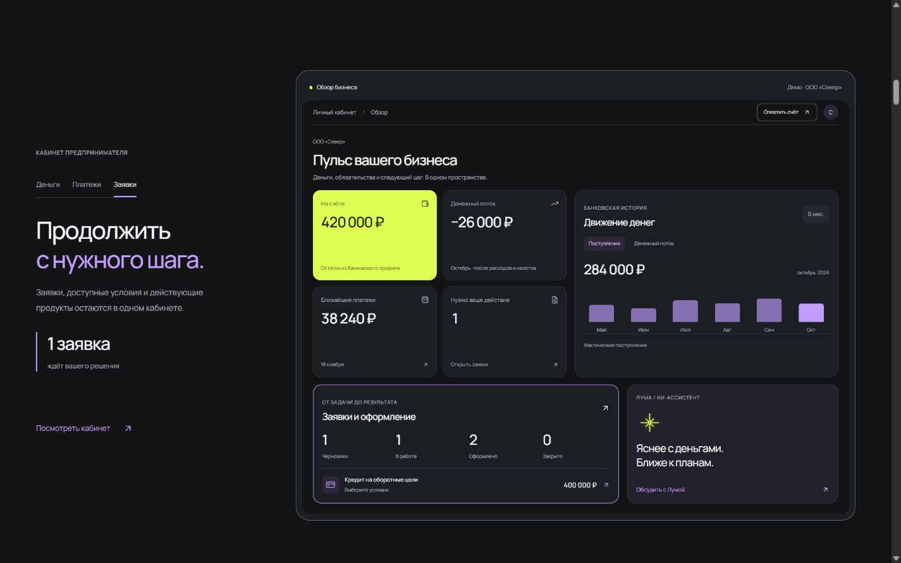

# Визуальная проверка лендинга — 25 октября 2026

Проверка выполнена по UI Design System и Senior Frontend с сохранением действующих цветов, шрифтов и карточек.

## Исправления

1. Убрана лишняя верхняя граница `.ep-overview-showcase`: именно она проходила через пустое пространство слева от превью кабинета. Вычисленная ширина границы после исправления — 0 px.
2. Убрана дополнительная граница перед финальным призывом: на узком экране она дублировала разделитель последнего вопроса FAQ.
3. Суммы поступлений в светлой теме больше не используют яркий лайм на белом. Для текста, легенды и точек графика применён существующий токен `--success`. Контраст вырос с 1,13:1 до 6,68:1. В тёмной теме — 11,94:1.
4. Исправлено обрезание подсказки поступления в первой строке промо таймлайна. Раньше верх подсказки был на 5,77 px выше области прокрутки; теперь она раскрывается ниже маркера и полностью помещается в области.

## Темп трёх этапов и прокрутки

«Деньги → Платежи → Заявки» получили отдельный путь чтения `max(2200px, 260svh)` вместо 95svh. При высоте окна 900 px это 2340 px вместо 855 px. JS измеряет реальную разницу высот секции и закреплённой сцены, чтобы анимация не расходилась с CSS.

Переход между текстами: выход 220 мс, затем появление за 550 мс с мягким смещением за 650 мс. Подчёркивание и цвет этапа меняются за 550 мс. Прежняя защита от дрожания на границах сохранена; сами этапы остаются неинтерактивным индикатором.

Общий темп колеса снижен до промежуточного: потолок скорости 950 вместо 1350 px/с; обычное событие 120 px даёт 108 вместо 126 px; единичный скачок ограничен 140 px, очередь — 220 px. Это быстрее прежнего медленного режима (540 px/с и 81 px), но спокойнее последней версии. Настройки локального таймлайна кабинета не менялись.

В `overview-pacing.json` сохранён проход колесом при 1440 × 900: первые пять событий сохраняют «Деньги», шестое переводит к «Платежам», следующие пять сохраняют этот этап, двенадцатое переводит к «Заявкам».

## Проверенная область

- Светлая и тёмная темы: начало страницы, превью кабинета, календарь/таймлайн, продуктовые сцены и завершение.
- 1440 × 900: границы, чтение этапов, полная видимость превью.
- 1366 × 650: во всех пяти продуктовых сценах текст и иллюстрация помещаются в рамку; горизонтального переполнения нет.
- 320 × 844: продукты, последовательность оформления, FAQ и финальный блок; горизонтального переполнения и обрезанного текста в проверенных видимых элементах не найдено.
- Подсказка проверена с клавиатурным фокусом. Её границы после исправления: y=472,30…527,07 внутри области y=379,30…721,30.
- Пройдены 12 целевых frontend-тестов для колеса, превью кабинета и календаря. Сборка и lint завершены. Остаются существующие предупреждения о размере чанка и Fast Refresh в `decision-trace.tsx`.
- Обновлены контейнеры на 18000 и 18007; исходная вкладка лендинга перезагружена и подтвердила новый скрипт `index-Cx13Agem.js`.

Это проверка перечисленных экранов и состояний, а не заявление об отсутствии всех возможных визуальных дефектов.

