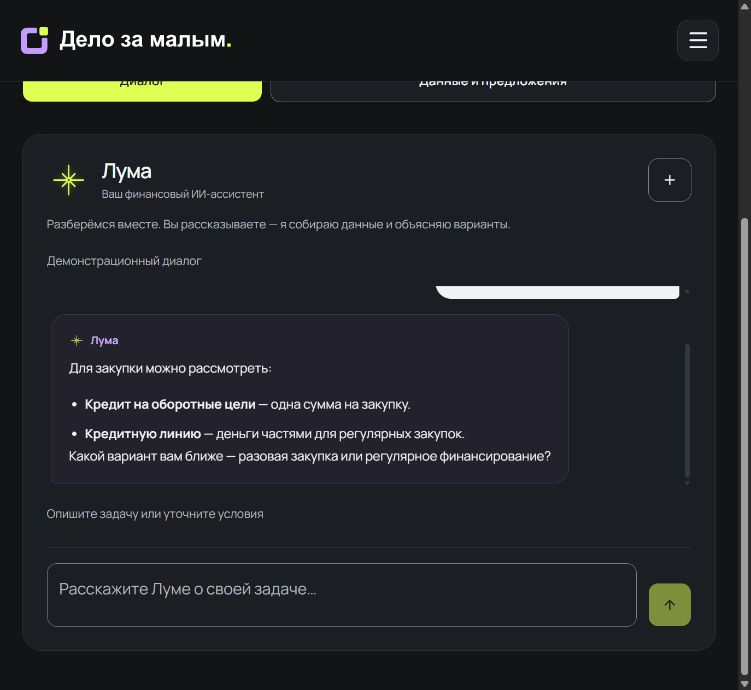

# Контекст Лумы и проверка интерфейса — 24 октября 2026

## Исправления

- При обсуждении продуктов карточка суммы скрывается, если она не соответствует
  последнему вопросу ассистента. Когда разговор возвращается к сбору суммы,
  соответствующее поле снова доступно. Незавершённые предложения не меняют заявку
  без подтверждения.
- Вопросы «Какие продукты…», «Сколько можно взять…», «Какую сумму банк…» направляются
  в диалог о продуктах, даже если раньше приложение ожидало ответ с суммой.
- Сбор будущих операций получает отдельный `input_kind`. Предыдущий вопрос формы
  не должен превращать сумму платежа поставщику в сумму кредита. Для неполной даты
  сохраняется операция с `date: null`, затем приложение уточняет дату.
- Новые ответы просят обычные абзацы и точные названия продуктов. Границы каталога
  отделены от персонального предложения. Уже сохранённая Markdown-разметка
  отображается списками и выделением; HTML и активные ссылки не исполняются.
- Удалён отдельный редактор суммы в собранных данных. Колесо мыши над панелью без
  переполнения или у её границы может прокручивать страницу.
- Промосцена кабинета остаётся целиком видимой во время трёх этапов; текстовые
  состояния не накладываются. Движение сообщений и карточек в промосцене Лумы
  сокращено и растянуто на больший участок анимации.
- Из карточек портфеля убран блок «Состав платежа». Подробности сохранены в графике.
- Выставочный профиль получил запас нагрузки для проверки новых продуктов при
  действующих обязательствах. Правила скоринга не отключены; см. [подготовку демо](../../docs/DEMO.md).

## Как проверяли

Полный backend-прогон: **503 теста, 502 прошли, 1 пропущен** — Windows не разрешает
создать символическую ссылку в отдельном тесте. Frontend: **146/146**, отдельно
интеграция с настоящим API во временных базах: **20/20**.
[Backend-лог](backend-tests.txt), [frontend-лог](frontend-tests.txt).
Сборка проходит. Сохраняются
предупреждения о размере JS-чанка и существующем экспорте константы из React-компонента.

Браузерная проверка включает переключение трёх глав промосцены колесом, видимость
кабинета, отсутствие наложения текста, короткий диалог без карточки суммы, чтение
списков без `**` и передачу прокрутки странице из обеих панелей. Воспроизведение
проблемного разговора выполнено в отдельной временной базе, без новых тестовых
заявок в пользовательском кабинете. На работающем стенде запрос линии на 1 млн ₽
получил варианты на 6 и 12 месяцев при неизменном остатке счёта 129 976,99 ₽.

## Реальная модель и история прогонов

Использована **MiniMaxAI/MiniMax-M2.7 через API Dahl**. Это проверка выбранных
синтетических диалогов, а не доказательство безошибочности модели, приёмка Gemma
или проверка развёртывания на VPS. Все исходные результаты сохранены, включая
неуспешные прогоны.

| Файл | Результат | Причина следующего изменения |
|---|---:|---|
| [baseline.json](baseline.json) | 11/12 | Ошибка оценщика: при отсутствии активных кредитов банковский модуль сам считает пустой график обязательств полным. Модель не возвращала подтверждение. Добавлен отдельный тест, который по-прежнему отклоняет неподтверждённые обязательства при наличии долга. |
| [first-candidate.json](first-candidate.json) | 12/14 | Та же ошибка оценщика и один таймаут провайдера. |
| [candidate-pass.json](candidate-pass.json) | 14/14 | Полный проход выбранного набора. |
| [repeat-date-failure.json](repeat-date-failure.json) | 13/14 | Повтор выявил путаницу суммы операции и суммы кредита при неполной дате. Добавлен контекст вида сообщения. |
| [operation-context.json](operation-context.json) | 6/6 | Два сценария дат, по три повтора. Не является оценкой статистической независимости ответов провайдера. |
| [repeat-routing-failure.json](repeat-routing-failure.json) | 13/14 | Вопрос о продуктах ошибочно направлялся в ограниченный сбор фактов. Исправлена маршрутизация, добавлен тест трёх формулировок вопроса. |
| [final.json](final.json), [JSONL](final.jsonl) | 13/14 | Все 13 полученных ответов прошли проверки; запрос объяснения отличий продуктов завершился таймаутом внешнего API после 120 секунд с ограниченным повтором. Это не полностью зелёная приёмка доступности провайдера. Выборочно перезапускать упавший случай для замены результата не стали. |

Финальная конфигурация сохраняет таймаут 120 секунд из используемого `.env`.
Доступность и задержки внешнего API остаются ограничением этого стенда. Предыдущий
полностью зелёный прогон 14/14 не заменяет финальный результат 13/14. Заявки не
изменяются при ошибке генерации; интерфейс позволяет повторить сообщение.



Набор для воспроизведения: [cases.json](cases.json). В нём первые 12 прежних сценариев
и два новых: названия/границы продуктов и объяснение различий без изменения заявки.

```shell
uv run --frozen python -m scripts.run_dialogue_evaluation --env-file .env --cases reports/luma-context-2026-10-24/cases.json --output reports/luma-context-new-run.json --workers 2
uv run --frozen python -m unittest discover -s tests
uv run --frozen python -m scripts.run_frontend_checks
npm --prefix frontend run test -- --exclude "src/integration/**"
npm --prefix frontend run build
```

Секреты провайдера в отчёты не включены. Для обоих действующих Docker-кабинетов
перед обновлением истории черновиков создана резервная копия SQLite. Поданные заявки,
подписанные договоры, параметры потребности и история операций не удалялись.
