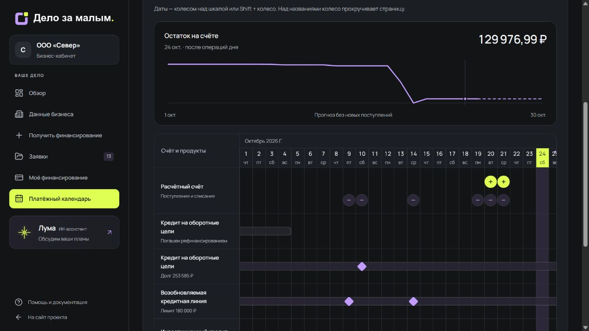

# Лума и движение денег: проверка 25 октября 2026

## Исправленная ошибка

Вопрос «а что можно уточнить?» после выбора кредитной линии на 3 000 000 ₽ / 12 месяцев приводил к `assistant_invalid_response`. Модель возвращала `ask_clarification` вместе с изменениями, повторявшими уже собранные значения. Контракт отклонял такой ответ. Один из повторов также содержал неподтверждённое требование поручителя.

Теперь вопросы о следующем шаге получают справку из текущего состояния заявки, включая неподтверждённые параметры и действительно недостающие поля. Такие ответы не требуют внешней модели и не изменяют заявку. В остальных ответах нормализуются только точные повторы известных значений; новые, неизвестные или привилегированные поля по-прежнему проходят строгую проверку. Ошибки отправки предлагают повтор запроса, конфликт версий — обновление состояния. Карточка ввода не остаётся под несвязанным вопросом модели.

## Повторяемая проверка

Набор `cases.json`: 12 базовых сценариев + 8 продолжений реального проблемного диалога. Каждый сценарий выполнен трижды, с отдельной временной базой для каждого прогона. Live-данные не изменялись.

| Проверка | До | После |
| --- | ---: | ---: |
| Успешные испытания | 58 / 60 | 60 / 60 |
| Стабильно успешные сценарии, 3 / 3 | 18 / 20 | 20 / 20 |
| Нарушения ограничений вызова инструментов | — | 0 / 60 |

Провайдер: MiniMaxAI/MiniMax-M2.7 через Dahl. Это проверка полного диалогового пути: часть вопросов теперь обслуживается кодом без генерации модели. Она не является проверкой Gemma или Qwen. Исходные неудачи сохранены: ошибка формата и внешний таймаут 120 секунд. Выборочных перезапусков и исключённых случаев нет.

Проверки траекторий, стабильности и регрессии находятся в `trajectory.txt`, `flakes.txt`, `gate.txt`. Средняя разница по сценариям +0,033; 95% CI [−0,015; +0,081]. Небольшая выборка не доказывает отсутствие всех будущих ошибок; три повтора одного сценария не считаются независимыми сценариями. После кандидатного прогона добавлены обработка пустого intent/changes и восстановление обязательного вопроса после бокового разговора; эти ветки покрыты модульными тестами. Системный промпт в этой итерации не менялся.

Воспроизведение (использует настроенную модель, отдельные временные базы):

```powershell
uv run --frozen python -m scripts.run_dialogue_evaluation --env-file .env --cases reports/luma-reliability-2026-10-25/cases.json --trials 3 --workers 2 --output candidate.json
uv run --frozen python -m unittest discover -s tests
npm --prefix frontend run test
uv run --frozen python -m scripts.run_frontend_checks
```

## Расчётный счёт и график

В «Платёжном календаре → Таймлайн» добавлены строка расчётного счёта с поступлениями/списаниями и график остатка по дням. Клик по графику или операции открывает детали; поддерживается клавиатура. На масштабе трёх месяцев маркеры счёта объединяются по неделям, детали сохраняют даты каждой операции. При изменении ширины сохраняется положение шкалы.

Источник истории — фактически выполненные операции кабинета. Выдача кредита, получение денег по линии и погашения меняют остаток; неиспользованный лимит и рефинансирование старого долга не становятся поступлением на счёт. Оплата поставщику с овердрафтом показана полной суммой списания и отдельным финансированием недостающей части: их сумма точно совпадает с изменением денег счёта. Дубли связанных операций исключены.

График привязан к текущему остатку. Прошлые дни восстановлены по этим проводкам. Будущие дни учитывают известные предстоящие кредитные платежи, без новых поступлений, черновиков планов или выдуманной выручки. Отрицательный прогноз допускается и обозначается как «Не хватает на платежи», с объяснением, что это не фактический долг счёта. Это не полная банковская выписка до начала истории кабинета и не обещание будущего остатка. Будущие заявки на досрочное погашение отражаются после исполнения.

## Карточки финансирования

Карточки больше не растягиваются по высоте соседей. Вместо пустого пространства показаны три ближайшие даты и суммы из действующего графика. Отсрочка основного долга поясняется только при нулевой доле его погашения и наличии следующей даты возврата в графике. В мини-график не попадают дубли событий и поручения на досрочное списание. Закрытые продукты будущих платежей не показывают. При одном или двух платежах блок занимает доступную ширину, на узком экране становится списком.

## Проверки реализации

- Backend: 511 тестов, 510 успешных, 1 пропущен из-за ограничения symlink в Windows.
- Frontend: 152 модульных теста; отдельно 20 интеграционных тестов с настоящим API и временными базами.
- В промежуточном frontend-прогоне выявилась тестовая фикстура, назначавшая разным платежам один event_id. Фикстура исправлена с сохранением проверки суммирования; после этого весь набор прошёл 152/152. Исходное падение сохранено в `frontend-intermediate-failure.txt`.
- Сборка и lint завершены; остаются существующие предупреждения о размере JS-чанка и Fast Refresh в `decision-trace.tsx`.
- Контраст подписи графика: 9,00:1 в тёмной теме и 5,24:1 в светлой; линия — 8,41:1 и 5,36:1. Расчёт в `contrast.txt`.
- Визуально проверены обычный/узкий экраны, тёмная/светлая темы, месячный/квартальный масштабы, детали дня/недели и клавиатурное управление.
- Проверены локальные контейнеры на портах 18000 и 18007, без сброса данных. В обоих остаток API календаря совпал с профилем, доступно 16 проводок счёта. Исходный сохранённый диалог проверен чтением без вызова модели и без записи в заявку.


