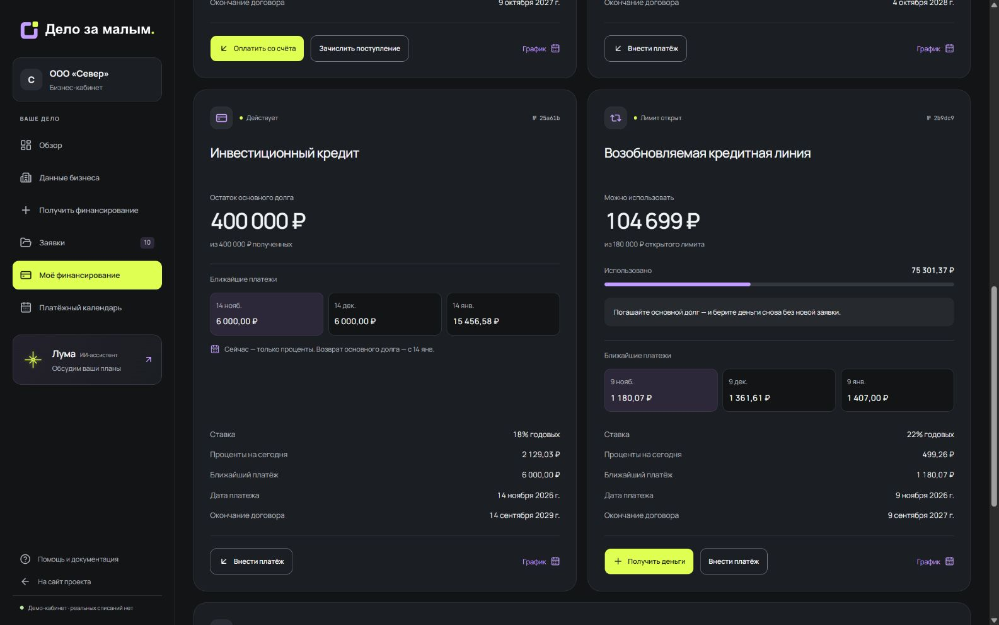

# Portfolio card row alignment

Cards stretch to the natural height of their grid row. On multi-column layouts, flexible spacing above the facts aligns rates, dates, dividers and actions. No fixed card height is imposed. The three upcoming payments remain, following the user's clarification.

Verified in the browser against the existing demo data:

- 1600 × 1000: first pair 773.15 px each; investment loan and credit line 802.75 px each. Facts and actions match exactly within both rows.
- 2100 × 1000: first three cards 777.24 px each; remaining pair 806.84 px each. Actions match within each row.
- 390 × 844: one column; cards and upcoming payment lists have no horizontal overflow.
- Production frontend build passed. Existing large-chunk warning remains.

Updated the frontend served on local ports 18000 and 18007. No application or account data was changed.

