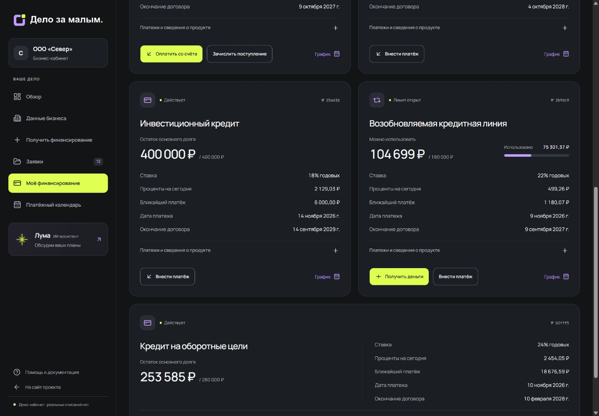

# Visible limit indicators and currency

- Restored ₽ in the smaller denominator; no trailing words.
- Limit utilization is visible beside the main amount, outside the collapsed product details. No percentage meter is reused for loans.
- At 1440 × 1000 paired cards are 517.34 px tall; at 1280 × 900 they are 515.56 px tall. The two limit meters are 156 px wide and do not create extra vertical space.
- At 390 × 844 the meters move below the amount and use the available width. No card or page horizontal overflow.
- Six portfolio tests and production build passed. Both local frontends updated; no account or application writes.

