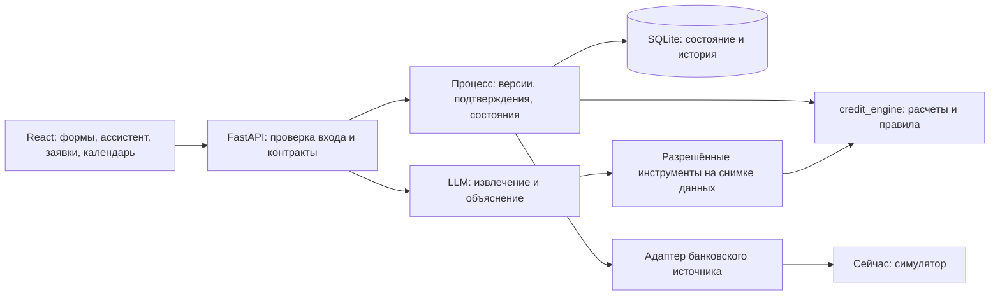

# «Дело за малым»: полезные скиллы, готовность и план доработки

Дата обзора: **22 октября 2026 года**. Проект: `C:/Users/user/Documents/Alfa_Hack`.

**Главный вывод.** У проекта уже есть функциональная основа для содержательной демонстрации: два продукта, альтернативные условия, денежные сценарии, документы, оформление, календарь и учёт нового кредита. Следующее существенное улучшение даст доведение пользовательских путей, надёжности диалога и воспроизводимости поставки. Процент «общей готовности» здесь был бы произвольным: функциональный MVP, качество UX, надёжность провайдера и промышленная банковская эксплуатация находятся на разных стадиях.

## 1. Что именно изучено

- Всё дерево [alirezarezvani/claude-skills](https://github.com/alirezarezvani/claude-skills/tree/27cfcd0fb0a41f60adffcbd5271fdf8839f86ed2), снимок `27cfcd0fb0a41f60adffcbd5271fdf8839f86ed2`: 5 782 отслеживаемых записи, 398 исходных `SKILL.md` в 20 верхнеуровневых разделах, 382 уникальных значения `name`. Скрытые зеркала для разных агентов исключены из этого счёта. Есть повторные публикации, командные обёртки, маршрутизаторы и тестовый пример; 398 не означает 398 независимых инструментов.
- Для всех исходных скиллов собраны назначение, заголовки, расположение и состав вспомогательных ресурсов. У наиболее релевантных изучены рабочие инструкции; у отдельных инструментов — реализация. Это полный обзор каталога и углублённый отбор, **не построчный аудит всех 786 Python-файлов** внешнего репозитория.
- Весь локальный список файлов проекта, MVP, роли, архитектура, frontend roadmap, кредитные и API-контракты, ключевые модули backend/frontend/LLM, существующие тесты и отчёты экспериментов. Также прочитан недавний контекст чата «Спроектировать стратегию хакатона».
- Базовый коммит проекта при начале обзора: `8070bef3b783e999b259e54f118c52eed64eee5e`. Во время обзора в соседнем чате начались изменения UI в том же рабочем каталоге. Результаты проверок ниже не следует автоматически переносить на последующий финальный коммит этих изменений.
- Скиллы не устанавливались, код приложения в рамках этого обзора не менялся. Созданы этот отчёт и [полный каталог с оценкой применимости](skills-catalog-2026-10-22.md).

Полный каталог содержит все 398 исходных записей, ссылки на конкретные `SKILL.md`, назначение автора, оценку полезности для нашей стадии и локальную доступность. Формулировки «production-ready» в исходной библиотеке не принимаются за доказательство качества.

### Применимость всех разделов библиотеки

| Раздел | Файлов SKILL.md | Для нашего проекта |
|---|---:|---|
| engineering-team | 54 | Основные роли frontend/backend/architecture, QA, AI security, accessibility, Playwright |
| engineering | 97 | Evals, CI, API, наблюдаемость, инструменты работы с существующим кодом; значительная часть не нужна сейчас |
| product-team | 17 | UX, дизайн-система, требования, приоритизация и продуктовые проверки |
| marketing-skill | 50 | Выборочно: формы, первый опыт, бренд, тексты; рекламные и SEO-процессы не являются ближайшим приоритетом |
| marketing | 7 | Лендинг по необходимости; LinkedIn-направление сейчас вне задачи |
| research-ops | 6 | Product research и разбор интервью после появления настоящих наблюдений |
| research | 10 | Поиск и анализ материалов по отдельной потребности; не заменяет изучение готового продукта |
| project-management | 9 | Выборочно; полноценное внедрение Jira/Confluence для команды из трёх человек сейчас мало что даст |
| finance | 8 | В основном корпоративные финансы, оценка бизнеса и инвестиций; не готовый кредитный движок |
| business-growth | 5 | Подготовка PoC или ответа на требования возможна позднее; customer success/revenue ops сейчас не нужны |
| business-operations | 7 | Процессы и инструкции возможны позднее; операционная система компании не является задачей хакатона |
| commercial | 8 | Ценообразование, сделки, партнёрства и RFP — после определения модели внедрения |
| c-level-advisor | 46 | Выборочная критика стратегии и питча; запуск всего «совета директоров» избыточен |
| c-level-agents | 22 | Служебные команды и персоны для управленческой работы, не функции нашего продукта |
| compliance-os | 9 | Не переносить целиком: применимость стандартов определяется отдельно |
| ra-qm-team | 19 | В основном медицинское качество и зарубежный compliance; не банковские кредитные правила |
| productivity | 12 | Личная организация работы; не закрывает текущие пробелы кабинета |
| agent-launcher | 6 | Специфичный запуск Claude Managed Agents; наш действующий LLM-runtime другой |
| loop-library | 1 | Общие циклы работы агентов; сейчас важнее конкретные проверки уже имеющегося процесса |
| markdown-html | 5 | Оформление отчётов, ревью и презентаций; не основа React-кабинета |

## 2. Контекст и фактическая готовность проекта

### Продукт и команда

«Дело за малым» — кредитный кабинет существующего клиента малого/микробизнеса. Предприниматель описывает задачу, получает предварительные варианты, выбирает условия, отправляет заявку и проходит демонстрационное оформление. Есть самостоятельный подбор и подбор с ассистентом; их черновики независимы. Общими остаются банковский профиль, обязательства, заявки и календарь.

Полный путь реализован для **разового кредита на оборотные цели и овердрафта**. Основное конкурентное преимущество — поиск выполнимого варианта с объяснением: другая сумма, срок, условия или механика финансирования. Показать влияние финансирования и задержки поступления на деньги бизнеса полезнее, чем просто выдать ответ «одобрено/отказано».

Тимофей отвечает за продуктовую и финансовую логику, Илья — за LLM и извлечение, Андрей — за кабинет, backend и интеграцию. Это важно для плана: единственный fullstack-разработчик не сможет одновременно вести редизайн, OCR, новую инфраструктуру и новые кредитные продукты.

### Техническая основа

- React + TypeScript + Vite; TanStack Query, Zod, Tailwind и Radix. Общие UI-элементы и токены уже есть.
- FastAPI связывает процесс заявки, инструменты ассистента, документы и `credit_engine`.
- Расчёты используют `Decimal`; скоринг и решения задаются демонстрационными правилами. Обученная и проверенная на исходах дефолта модель здесь не заявлена.
- SQLite хранит агрегаты заявок и чатов, а также оригиналы документов. Есть транзакции, версии, история отправленных данных, проверки перед подписанием и защита от повторной отправки сообщения по `request_id`.
- В текущем корневом `.env` выбран **MiniMaxAI/MiniMax-M2.7** через внешний совместимый API, окно 16 384, резерв ответа 4 096, `json_object`, инструменты включены. Наличие конфигурации не доказывает текущую доступность провайдера. Gemma Q4 — отдельный локальный вариант/эксперимент, а не единственная актуальная конфигурация проекта. Секреты в отчёт не включены.

### Матрица готовности

| Область | Подтверждённое состояние | Что остаётся |
|---|---|---|
| Кредитная логика | Кредит, овердрафт, подбор альтернатив, ограничения, расчёт платежей и денежных сценариев реализованы | Подтверждать продуктовые граничные случаи; правила остаются демонстрационными |
| Жизненный цикл заявки | Подбор → выбор → отправка → результат/уточнения → условия → подписание → выдача/лимит | Банковские проверки, поручительство, подписание и выдача — симуляторы |
| Кабинет | Реальный React-интерфейс с API, отдельными черновиками, предложениями, документами и заявками | Полный пользовательский проход на компьютере и телефоне; сейчас этим занимается соседний чат |
| Календарь и следующий кредит | Выданный кредит учитывается в обязательствах и календаре; старые предложения требуют пересчёта | Проверить понятность событий и разграничение плана/исполнения. Реального учёта совершённых погашений нет |
| Документы | Текстовый PDF-счёт, сумма/дата, оригинал, страница/строка, исправление и подтверждение | OCR сканов/фото, иные документы и выписки не реализованы. Ограничения: 2 МБ, 8 страниц |
| Ассистент | Сбор и исправление данных, карточки уточнений, инструменты расчёта, подтверждение изменений | Надёжность первого ответа и задержки реального провайдера требуют отдельного контроля |
| RAG | Есть заготовленная структура | Рабочего retrieval pipeline нет. Для двух продуктов необходимость отдельного RAG ещё нужно обосновать |
| Поставка | Есть Docker-сборка frontend + API, Caddy, настройки внешней модели, healthcheck и постоянный том | В этом обзоре не проверялись внешний VPS, DNS, HTTPS, квота модели и восстановление на целевом сервере |
| Пользователи и доступ | Основной API обслуживает общего демонстрационного клиента | Полноценная авторизация и изоляция реальных клиентов не реализованы; это задача банковского пилота |

Основные источники внутри проекта: `docs/MVP.md`, `frontend/docs/ROADMAP.md`, `backend/service.py`, `backend/workspace.py`, `backend/portfolio.py`, `backend/store.py`, `backend/main.py`, `backend/assistant.py`, `credit_engine/`, `frontend/src/features/`.

### Что проверено в этом обзоре

| Проверка | Результат | Ограничение вывода |
|---|---|---|
| Python unittest discover | 369 обнаруженных тестов: **368 успешных, 1 пропущен** | Это не новый прогон живого LLM и не проверка реального банка |
| TypeScript, oxlint, production build | Успешно | Сборка сама по себе не доказывает UX, доступность или скорость загрузки |
| Обычный Vitest | 15 успешных, 9 интеграционных пропущены без `CABINET_TEST_URL` | Нельзя называть это «24/24 проверены» |
| Vitest с настоящим FastAPI и временной БД | Первый прогон: 8/9; повтор: 9/9 | Одна нестабильная проверка смены задачи требует диагностики |
| Сохранённый OpenAPI против `create_app().openapi()` | Полное совпадение; 37 путей | API-контракт актуален на момент сравнения |

Интеграционные проверки запускались с `DemoAssistant`; база проекта и квота реального провайдера не использовались. Они выполняют React в **jsdom**, поэтому не заменяют браузерный E2E, проверку размеров и взаимодействие с экранной клавиатурой.

Нестабильное место: `frontend/src/integration/cabinet.integration.test.tsx:479`. После возврата к задаче и выбора закупки тест однажды прочитал прежнее «Рассчитаем: Овердрафт» вместо кредита. Повтор прошёл до начала последующих UI-правок. Возможна гонка ожидания обновления данных; причина не установлена. Нельзя ни объявлять подтверждённую постоянную ошибку продукта, ни скрывать первый неуспешный прогон.

### Что известно о реальном LLM из сохранённых результатов

`tmp/dialogue-evaluation-final.json`, `tmp/dialogue-evaluation-retry.json` и `tmp/dialogue-summary.json` фиксируют **11/15 с первого прохода и 15/15 после повторов четырёх случаев**. Первые ошибки отмечены как `assistant_unavailable`; среди них есть ожидание примерно 120 секунд. Успешный повтор исправления плана занял около 51 секунды.

**Обновление после применения скиллов:** полная серия 15 сценариев × 3 повтора дала 41/45 успешных испытаний; 13 сценариев выдержали все три повтора. Найдены ошибка схемы `question` и нестабильность критического отказа. Результат после выборочных повторов не является оценкой стабильности. Подробности и следующие шаги: [повторяемость диалогов](agent-regression-evals-2026-10-22.md); выполненные UI-исправления: [формы и доступность](form-accessibility-audit-2026-10-22.md).

Это свидетельство работоспособной интеграции и одновременно недостаточной подтверждённой устойчивости. Четыре исправленных повтором случая не превращают исходный прогон в безошибочный. Эти результаты прочитаны из артефактов, а не получены заново в данном обзоре. Внешнюю доступность нельзя автоматически считать ошибкой промпта: надо разнести причины на транспорт, квоту, таймаут, схему, извлечение и инструмент.

## 3. Какие скиллы дадут проекту наибольшую пользу

«Есть» означает наличие локального скилла на момент обзора. Добавление в таблицу — рекомендация использования, а не установка.

### Использовать в ближайшем проходе

| Скилл | Почему полезен именно нам | Конкретный результат | Локально |
|---|---|---|---|
| [ux-researcher-designer](https://github.com/alirezarezvani/claude-skills/blob/27cfcd0fb0a41f60adffcbd5271fdf8839f86ed2/product-team/skills/ux-researcher-designer/SKILL.md) | Уже есть длинный путь и два способа подбора; нужно проверить понимание клиентом, а не придумать ещё один экран | Карта 4 основных задач, план usability-теста, список затруднений с доказательствами и приоритетом | Есть |
| [form-cro](https://github.com/alirezarezvani/claude-skills/blob/27cfcd0fb0a41f60adffcbd5271fdf8839f86ed2/marketing-skill/skills/form-cro/SKILL.md) | Форма потребности, операции, уточнения и подтверждения — основные места трения | Матрица «поле → зачем → источник → когда спрашивать», ясные подписи и ошибки, обоснованные обязательные поля | Добавить |
| [ui-design-system](https://github.com/alirezarezvani/claude-skills/blob/27cfcd0fb0a41f60adffcbd5271fdf8839f86ed2/product-team/skills/ui-design-system/SKILL.md) | Уже есть `tokens.css`, общие контролы и фиолетовая визуальная система | Единые состояния карточек, действий, источников данных, ошибок и сравнения условий | Есть |
| [senior-frontend](https://github.com/alirezarezvani/claude-skills/blob/27cfcd0fb0a41f60adffcbd5271fdf8839f86ed2/engineering-team/skills/senior-frontend/SKILL.md) | Кабинет на подходящем React-стеке; важны согласованное состояние и мобильные переходы | Диагностика обновления данных, управление фокусом, поведение при 409, сохранение ввода и точечное упрощение крупных компонентов | Есть |
| [a11y-audit](https://github.com/alirezarezvani/claude-skills/blob/27cfcd0fb0a41f60adffcbd5271fdf8839f86ed2/engineering-team/a11y-audit/skills/a11y-audit/SKILL.md) | Финансовые таблицы, календарь, диалог и изменяющаяся рабочая область требуют внимания к доступности | Проверка контраста, клавиатуры, подписей, фокуса и объявлений статуса с повторной проверкой исправлений | Добавить |
| [Playwright Pro, вход pw](https://github.com/alirezarezvani/claude-skills/blob/27cfcd0fb0a41f60adffcbd5271fdf8839f86ed2/engineering-team/playwright-pro/skills/pw/SKILL.md) | Наши frontend-интеграции пока используют jsdom, не настоящий браузер | Несколько браузерных E2E по кредиту, овердрафту, исправлению, календарю и ошибкам; снимки desktop/mobile | Пакет есть |
| [senior-prompt-engineer](https://github.com/alirezarezvani/claude-skills/blob/27cfcd0fb0a41f60adffcbd5271fdf8839f86ed2/engineering-team/skills/senior-prompt-engineer/SKILL.md) | Есть контракт и 15 диалоговых случаев, но качество первого ответа и задержки недостаточно устойчивы | Зафиксированный baseline; изменения промпта по одному; оценка извлечения, намерения, инструментов и затрат контекста | Есть |
| [agent-regression-evals](https://github.com/alirezarezvani/claude-skills/blob/27cfcd0fb0a41f60adffcbd5271fdf8839f86ed2/engineering/skills/agent-regression-evals/SKILL.md) | Сводка «все прошли после повтора» скрывает нестабильность | Повторяемые испытания baseline/candidate, критические случаи, проверка запрещённых действий и отчёт о нестабильных кейсах | Добавить |
| [code-to-prd](https://github.com/alirezarezvani/claude-skills/blob/27cfcd0fb0a41f60adffcbd5271fdf8839f86ed2/product-team/code-to-prd/skills/code-to-prd/SKILL.md) | Реализация обогнала часть описаний | Матрица «требование → экран/API → код → проверка → ограничение» и исправленная документация | Добавить |
| [product-manager-toolkit](https://github.com/alirezarezvani/claude-skills/blob/27cfcd0fb0a41f60adffcbd5271fdf8839f86ed2/product-team/skills/product-manager-toolkit/SKILL.md) | Потенциальных расширений больше, чем ресурсов команды | Короткий backlog с эффектом для клиента/демо, уверенностью, трудоёмкостью и владельцем | Добавить |
| [ci-cd-pipeline-builder](https://github.com/alirezarezvani/claude-skills/blob/27cfcd0fb0a41f60adffcbd5271fdf8839f86ed2/engineering/skills/ci-cd-pipeline-builder/SKILL.md) | Есть полезные тесты и lock-файлы, но в репозитории не обнаружен pipeline GitHub/GitLab/Jenkins/Azure | Проверки Python + frontend + API-интеграция + сборка; отдельный контролируемый прогон живого LLM | Добавить |
| [ai-security](https://github.com/alirezarezvani/claude-skills/blob/27cfcd0fb0a41f60adffcbd5271fdf8839f86ed2/engineering-team/skills/ai-security/SKILL.md) | Сообщения, документы и web search — разные источники недоверенного текста | Прикладные случаи, где текст пытается изменить банковский факт, одобрить заявку или обойти подтверждение; проверка состояния после атаки | Есть |

Примечания к применению:

- `form-cro` преимущественно опирается на маркетинговые формы. Его ориентир «3–5 полей» нельзя механически применять к банковскому расчёту: необходимые финансовые сведения не удаляем ради короткой анкеты. Оптимизируем момент запроса и используем известные данные.
- `ui-design-system` должен развивать существующие `tokens.css`, Manrope и JetBrains Mono. Генерация новой темы с дефолтными шрифтами/палитрой сейчас создаст лишнюю работу.
- Статический сканер `a11y-audit` использует разбор исходного текста и регулярные выражения. Он помогает найти кандидатов на исправление; **его зелёный отчёт не доказывает полное соответствие WCAG**. Нужны проверки браузера, клавиатуры и фокуса.
- Скилл не заменяет измерение: текстовые оценки промпта, качества кода или UX сами по себе не являются метриками готовности продукта.

### Следующие по полезности, по конкретной задаче

| Скилл | Когда применять |
|---|---|
| [senior-architect](https://github.com/alirezarezvani/claude-skills/blob/27cfcd0fb0a41f60adffcbd5271fdf8839f86ed2/engineering-team/skills/senior-architect/SKILL.md) | Зафиксировать границы банковского процесса, движка и LLM; описать решение о сохранении модульного монолита |
| [api-design-reviewer](https://github.com/alirezarezvani/claude-skills/blob/27cfcd0fb0a41f60adffcbd5271fdf8839f86ed2/engineering/skills/api-design-reviewer/SKILL.md) | При изменениях контрактов и ошибок API. Сохранённый OpenAPI сейчас совпадает с приложением; поддерживать это в CI |
| [docker-development](https://github.com/alirezarezvani/claude-skills/blob/27cfcd0fb0a41f60adffcbd5271fdf8839f86ed2/engineering/docker-development/skills/docker-development/SKILL.md) | Проверить воспроизводимость уже имеющейся сборки, ограничения стенда и сохранение данных |
| [runbook-generator](https://github.com/alirezarezvani/claude-skills/blob/27cfcd0fb0a41f60adffcbd5271fdf8839f86ed2/engineering/skills/runbook-generator/SKILL.md) | Подготовить запуск, проверку, backup/restore, обновление и откат стенда |
| [observability-designer](https://github.com/alirezarezvani/claude-skills/blob/27cfcd0fb0a41f60adffcbd5271fdf8839f86ed2/engineering/skills/observability-designer/SKILL.md) | Добавить минимальные измерения ошибок/задержек модели и API. Начать с полезных метрик и correlation ID, не с большого мониторингового кластера |
| [spec-driven-workflow](https://github.com/alirezarezvani/claude-skills/blob/27cfcd0fb0a41f60adffcbd5271fdf8839f86ed2/engineering/skills/spec-driven-workflow/SKILL.md) | Взять шаблоны критериев приёмки для конкретной доработки. Полный тяжёлый процесс спецификации не нужен каждой косметической правке |
| [product-research](https://github.com/alirezarezvani/claude-skills/blob/27cfcd0fb0a41f60adffcbd5271fdf8839f86ed2/research-ops/skills/product-research/SKILL.md) | Подготовить и систематизировать наблюдения реальных участников; не выдавать выдуманные персоны за исследование |
| [onboarding-cro](https://github.com/alirezarezvani/claude-skills/blob/27cfcd0fb0a41f60adffcbd5271fdf8839f86ed2/marketing-skill/skills/onboarding-cro/SKILL.md) | Улучшить первый запуск и пустые состояния, если пользователь не понимает, с чего начать |

### Что пока не стоит делать только ради наличия скилла

- `rag-architect` — после подтверждения потребности в большом версионируемом корпусе. Сейчас два продукта; достоверный каталог и релевантный короткий контекст могут быть достаточны.
- `senior-data-scientist` / `senior-ml-engineer` — для обучения скоринга только после получения подходящих размеченных данных и постановки проверки. Синтетические демонстрационные сценарии не подтверждают качество прогнозирования дефолта.
- `financial-analyst` — анализ финансов и оценки бизнеса, не замена `credit_engine`; `stock-analysis` занимается публичными компаниями, `saas-metrics-coach` — SaaS-метриками.
- `risk-management-specialist` в этой библиотеке — про ISO 14971 и медицинские устройства, а не про банковский кредитный риск.
- Kubernetes, Terraform, облачные архитектуры, новая СУБД, мультиагентные схемы и MCP не решают обнаруженный основной пробел. Для нынешнего небольшого стенда существующая архитектура уместна.
- `epic-design` и `landing` — возможны для промостраницы после основных сценариев. Их параллакс и кинематографические переходы не являются приоритетом рабочего кредитного кабинета.

## 4. Какие скиллы относятся к UI/UX

### Прямые инструменты дизайна и взаимодействия

| Скилл | Область | Наша применимость |
|---|---|---|
| `ux-researcher-designer` | Путь пользователя, usability-тесты, персоны на основании данных, исследовательские выводы | Очень высокая |
| `ui-design-system` | Токены, визуальная согласованность, компоненты, адаптивность, передача дизайна в разработку | Очень высокая |
| `senior-frontend` | Реализация интерфейса на React/TS, состояния, доступность и производительность | Очень высокая; это разработка UI, а не замена UX-исследования |
| `a11y-audit` | Доступность, контраст, клавиатура, ARIA, проверка исправлений | Высокая |
| [brand-guidelines](https://github.com/alirezarezvani/claude-skills/blob/27cfcd0fb0a41f60adffcbd5271fdf8839f86ed2/marketing-skill/skills/brand-guidelines/SKILL.md) | Визуальная идентичность, типографика, цвет, использование знака, голос продукта | Высокая для согласованности; не требует менять текущую тему |
| [epic-design](https://github.com/alirezarezvani/claude-skills/blob/27cfcd0fb0a41f60adffcbd5271fdf8839f86ed2/engineering-team/skills/epic-design/SKILL.md) | Композиция и эффектные web-страницы, слои, анимации при прокрутке | Выборочно для главной/питча |
| [apple-hig-expert](https://github.com/alirezarezvani/claude-skills/blob/27cfcd0fb0a41f60adffcbd5271fdf8839f86ed2/product-team/apple-hig-expert/skills/apple-hig-expert/SKILL.md) | Интерфейсы Apple-платформ по HIG | Низкая для нынешнего браузерного кабинета |
| [landing-page-generator](https://github.com/alirezarezvani/claude-skills/blob/27cfcd0fb0a41f60adffcbd5271fdf8839f86ed2/product-team/skills/landing-page-generator/SKILL.md) | React/TSX-блоки лендинга, структура страницы и CTA | Для главной после основного пути; адаптировать к Vite |
| [landing](https://github.com/alirezarezvani/claude-skills/blob/27cfcd0fb0a41f60adffcbd5271fdf8839f86ed2/marketing/landing/skills/landing/SKILL.md) | Отдельный HTML-лендинг с декоративными эффектами | Альтернатива для промостраницы, не второй frontend кабинета |
| [design-system из markdown-html](https://github.com/alirezarezvani/claude-skills/blob/27cfcd0fb0a41f60adffcbd5271fdf8839f86ed2/markdown-html/skills/design-system/SKILL.md) | Бренд и оформление HTML-документов/слайдов | Для отчёта или презентации; не то же самое, что `ui-design-system` |
| [email-template-builder](https://github.com/alirezarezvani/claude-skills/blob/27cfcd0fb0a41f60adffcbd5271fdf8839f86ed2/engineering-team/skills/email-template-builder/SKILL.md) | Транзакционные письма | Когда появятся уведомления; сейчас не основной UI |

### UX через формы, первый опыт и конверсию

| Скилл | Назначение | Где применить |
|---|---|---|
| `form-cro` | Формы заявок и других действий | Основной кандидат для потребности, уточнений и восстановления после ошибки |
| `onboarding-cro` | Активация и первый опыт | Первый подбор, пустые заявки и календарь |
| [signup-flow-cro](https://github.com/alirezarezvani/claude-skills/blob/27cfcd0fb0a41f60adffcbd5271fdf8839f86ed2/marketing-skill/skills/signup-flow-cro/SKILL.md) | Регистрация | При появлении реального входа/создания аккаунта |
| [page-cro](https://github.com/alirezarezvani/claude-skills/blob/27cfcd0fb0a41f60adffcbd5271fdf8839f86ed2/marketing-skill/skills/page-cro/SKILL.md) | Конверсия маркетинговых страниц | Главная и переход к подбору |
| [popup-cro](https://github.com/alirezarezvani/claude-skills/blob/27cfcd0fb0a41f60adffcbd5271fdf8839f86ed2/marketing-skill/skills/popup-cro/SKILL.md) | Модальные окна и всплывающие элементы | Только при конкретной проблеме с таким элементом |
| [paywall-upgrade-cro](https://github.com/alirezarezvani/claude-skills/blob/27cfcd0fb0a41f60adffcbd5271fdf8839f86ed2/marketing-skill/skills/paywall-upgrade-cro/SKILL.md) | Платные ограничения и апгрейд тарифа | Нынешнему продукту практически не нужен |

### Поддержка UX, а не самостоятельный дизайн

- **Исследования и проверка гипотез:** `product-research`, `product-discovery`, `interview-mapper`, `competitive-teardown`, `experiment-designer`, `product-analytics`, `ab-test-setup`, `analytics-tracking`.
- **Тексты и структура:** `copywriting`, `copy-editing`, `marketing-psychology`; `site-architecture` — прежде всего структура маркетингового сайта и URL, не готовый метод проектирования всего кабинета.
- **Проверка реализации:** пакет `playwright-pro` с `pw`, `pw-init`, `generate`, `fix`, `pw-review`, `coverage`, `report`, `browserstack`; также `browser-automation`, `full-page-screenshot`, `senior-qa`.
- **Визуальная подача материалов:** `md-document`, `md-review`, `md-slides`, `demo-video`. Эти инструменты полезны для представления работы, но не исправляют продуктовый путь.

Все ссылки на вспомогательные скиллы есть в полном каталоге. В этом снимке не найдены отдельные скиллы с именами `frontend-design`, `logo-design` и `logo-designer`; имеющиеся локально логотипные скиллы нельзя приписывать этой библиотеке.

## 5. Приоритетный план

**P0** — необходимо подтвердить перед демонстрацией. **P1** — следующий проход после стабильного основного пути. **P2** — банковский пилот или расширение продукта. Ниже задан порядок зависимостей; календарные сроки зависят от оставшегося времени хакатона и не подменяют его официальный дедлайн.

### Этап 0. Зафиксировать актуальное состояние и требования — P0

**Владелец:** Тимофей, с командой. **Скиллы:** `code-to-prd`, `product-manager-toolkit`.

1. Дождаться результата уже идущего в соседнем чате прохода четырёх путей: самостоятельный подбор, ассистент, календарь/второй кредит, телефон. Внести в backlog его фактические находки, а не дублировать разработку.
2. Зафиксировать commit, конфигурацию модели без секретов и матрицу «требование ТЗ → реализовано → доказательство → ограничение».
3. Перечислить, что показываем как работающую механику, что как симуляцию и что как будущее направление. Не создавать ощущение оформления факторинга/лизинга только из-за наличия названия в каталоге или вопросе.

**Приёмка:** у каждого обязательного требования есть один статус и проверка. Приоритеты опираются на клиентский эффект и критерии жюри; точные RICE-баллы без данных о reach не изображают объективную оценку.

### Этап 1. Уточнить поведение уже имеющихся функций — P0

**Владелец:** Тимофей + Андрей. **Скиллы:** `form-cro`, `spec-driven-workflow`, `senior-architect`.

Составить короткую таблицу правил, а не переписывать весь проект:

| Деталь | Что зафиксировать |
|---|---|
| Поля | Что банк уже знает, что клиент должен сообщить, что является предположением ассистента |
| Неизвестные сведения | `null` не превращается в ноль или отсутствие обязательств |
| Счёт поставщика | Стоимость покупки, собственные деньги и запрашиваемое финансирование — разные значения |
| Изменение задачи | Какие настройки сравнения сбрасываются; когда старый результат явно требует пересчёта |
| «А если» | Отдельный расчёт не изменяет подтверждённую заявку без действия применения |
| Предварительный/итоговый результат | Ясные подписи и разные доступные действия |
| Подтверждения | Отличать сохранение данных, выбор условий, отправку и подписание; убрать только действительно повторные подтверждения |
| Денежный план | Общие обязательства учитываются один раз, а выбранный план не дублирует их |
| Календарь | Получение кредита, открытие лимита, прогноз использования и факт платежа имеют разные смыслы |
| Неподдерживаемая цель | Понятный выход и объяснение границы автоматического подбора |

Большая часть этих правил **уже реализована**. Здесь задача — согласовать трактовку и подтвердить её одинаково в форме, ассистенте и отображении результатов. Новая доработка нужна только при найденном расхождении.

**Приёмка:** для каждого спорного поведения есть короткий Given/When/Then и владелец. Наиболее рискованные инварианты проверяются тестом, остальные — целевым просмотром.

### Этап 2. Завершить UX/UI и проверить его с людьми — P0

**Владелец:** Андрей; Тимофей ведёт наблюдения. **Скиллы:** `ux-researcher-designer`, `form-cro`, `ui-design-system`, `senior-frontend`, `a11y-audit`.

Четыре задания для проверки:

1. Подобрать оборотный кредит, сравнить сроки, выбрать вариант и понять стоимость.
2. Покрыть расход до поступления денег и понять нужный лимит овердрафта.
3. Исправить сумму/дату или проверить задержку поступления, сохранив различие между расчётом и изменением заявки.
4. После выдачи найти платёж в календаре и увидеть влияние первого кредита на следующий подбор.

Проверить эти задания на компьютере и узком экране. В ассистенте отдельно наблюдать, видит ли человек результат своего сообщения, изменение полей и следующий шаг без постоянного поиска по странице. В календаре проверить длинные названия, несколько событий одного дня и читаемость деталей. Это вопросы исследования, а не уже доказанные дефекты.

Сначала провести быстрый проход командой, затем по возможности привлечь **5 представителей целевых пользователей**. Если доступны только знакомые вне целевой аудитории, пометить их как участников проверки понятности интерфейса, а не как подтверждение спроса у предпринимателей. Фиксировать подсказки, ошибки, время и слова участников; синтетические персоны не выдавать за исследование.

**Приёмка:** нет блокирующих затруднений в четырёх заданиях; человеку понятны стоимость, статус результата, источник данных и действие подтверждения. Для малого числа участников приводить абсолютные результаты и ограничения, без вывода о конверсии всей аудитории.

Рабочие предположения для frontend-проверки: основной сценарий — desktop в браузере, мобильный путь также обязателен; кабинет не зависит от SEO, главная имеет отдельную презентационную задачу. Существующий Vite SPA подходит. Владелец доступности — Андрей; целевой уровень — WCAG AA.

Предлагаемые измеримые цели, **не результаты текущего измерения**: LCP ≤ 2 500 мс, INP ≤ 200 мс, CLS ≤ 0,1 на p75 выбранного устройства/сети; ориентир JS — до 200 КБ gzip начальной загрузки кабинета и до 80 КБ дополнительного кода маршрута; Lighthouse accessibility ≥ 95 и performance ≥ 85 при зафиксированных условиях. На небольшом демо без полевой статистики измерения лабораторные; при появлении трафика проверить p75. Ни Lighthouse, ни бюджет чанка не заменяют проверку пользовательских задач.

### Этап 3. Подтвердить устойчивость LLM — P0, параллельно этапу 2

**Владелец:** Илья; Тимофей задаёт ожидаемые финансовые факты. **Скиллы:** `senior-prompt-engineer`, `agent-regression-evals`, `ai-security`.

1. Сохранить текущий baseline, не переписывая историю неуспешных попыток.
2. Расширить набор от 15 до примерно 30–50 осмысленных диалоговых случаев. Включить суммы словами, относительные даты, исправления, неполные данные, «не знаю» против нуля, чужие сведения, неоднозначные ответы, отдельный расчёт и неверные/опасные требования к инструментам.
3. Отделить сбои транспорта/провайдера от нарушения схемы, ошибки извлечения, неверного намерения и неправильного объяснения. Отдельно учитывать безопасный отказ: он сохраняет данные, но может не решать задачу клиента.
4. Провести хотя бы 3 повтора на случай для baseline и кандидата с чистым состоянием. Отчитываться о результате первого обращения, устойчивости по повторениям, задержке и числе обращений к модели. Успех хотя бы однажды не равен устойчивому успеху.
5. Менять по одной причине: инструкции, контекст, структурированный ответ или провайдера. Не менять всё одновременно. Проверить заявленную поддержку JSON Schema инструментально, если решим включить этот режим.
6. Все значимые суммы, доступность и причины решения получать из движка; модель объясняет рассчитанное и предлагает изменения. Во время долгого ответа показать понятное ожидание, безопасный повтор и возможность продолжить через формы.

**Приёмка:** все критические случаи сохраняют инварианты в каждом повторе: нет самовольной отправки/подписания, подмены банковского факта, применения симуляции или дублирования операции. Нет ухудшения ранее устойчивых случаев. Для выполнения задачи — согласованный целевой first-pass показатель; рабочая цель ≥ 95% на зафиксированном наборе, при этом размер набора и все ошибки публикуются. Цель задержки — p95 ≤ 30 секунд для выбранного сценария; достижимость проверить измерением, не обещать по названию модели. При невозможности обеспечить это пересмотреть объём контекста, количество обращений и провайдера.

### Этап 4. Укрепить регрессию и исправить доказанные расхождения — P0

**Владелец:** Андрей; вся команда проверяет сценарии. **Скиллы:** Playwright Pro, `senior-frontend`, `api-design-reviewer`.

- Разобрать нестабильный интеграционный тест: ожидание актуального UI/версии, время уведомления Query и сохранение выбранной задачи. Исправлять причину; не заменять проверку произвольным sleep и не удалять её.
- Добавить небольшой набор настоящих браузерных E2E поверх существующих unit/jsdom-тестов: кредит до выдачи, овердрафт с планом, возврат и исправление, второй кредит с календарём, недоступность модели.
- Проверить 409 и обновление данных, восстановление после refresh, повтор запроса после потерянного ответа, устаревшее предложение и несовпадение извлечённых данных документа.
- Добавить в CI проверку совпадения сохранённого OpenAPI с приложением; сейчас контракт совпадает.
- Исправить точные несоответствия документации: `ARCHITECTURE.md:52` говорит о двух таблицах, а `backend/store.py` создаёт три; `BACKEND.md:104` указывает `user_version=1`, фактически `2`. Описания лабораторного агента и кабинета развести яснее.

**Приёмка:** финальный коммит имеет успешные Python, typecheck, lint, unit, интеграционные проверки с API и основные браузерные E2E. Нестабильный сценарий выдерживает серию целевых повторов. Повторить проверки после завершения параллельных UI-правок.

### Этап 5. Подготовить воспроизводимую демонстрационную поставку — P0

**Владелец:** Андрей; Илья проверяет модель. **Скиллы:** `ci-cd-pipeline-builder`, `docker-development`, `runbook-generator`; выборочно `observability-designer`.

1. Зафиксировать CI-команды из существующего проекта: Python 3.13+, Node 24+, lock-файлы, unittest, typecheck/lint/Vitest, интеграции с временным API, production build. Не использовать простой `vitest` как замену интеграциям: он их пропускает без переменной окружения.
2. Для VPS оставить текущую схему API + SQLite + Caddy; модель — снаружи. Локальный файл Gemma около 7,4 ГБ не помещается в конфигурацию VPS с 4 ГБ RAM вместе с остальным runtime.
3. На целевом сервере проверить внешнюю ссылку, frontend/API, HTTPS, модель и доступную квоту. Пройти реальные ключевые сценарии после развёртывания.
4. Проверить сохранение заявки при перезапуске, backup/restore SQLite и откат к предыдущему commit. Подготовить чистые синтетические демонстрационные данные.
5. Явно определить режим работы нескольких проверяющих: общий demo-клиент с понятным поведением либо изолированные demo-сессии. Это отдельное решение, а не скрытое обещание многопользовательского банка.
6. Собирать минимум полезных показателей: код ошибки, request/correlation ID, задержку API/LLM и число обращений; без вывода секретов и полного чувствительного содержимого в обычный лог.

**Приёмка:** другой участник команды запускает версию по инструкции; заявка переживает restart; демонстрация проходит по внешней ссылке; известен режим при недоступной модели. Публикация — отдельное последующее действие, в этом обзоре она не выполнялась.

### Этап 6. Подготовить показ результата — P0

**Владелец:** Тимофей, с командой. **Скиллы:** `product-manager-toolkit`; по необходимости `demo-video` или `md-slides`.

Сценарий показа: задача предпринимателя → известные банку данные → предварительные варианты и их стоимость → изменение даты поступления → объяснимый выбор → оформление → календарь → влияние первого кредита на следующий подбор. Показать одно затруднение и корректное восстановление. Подготовить резервные синтетические данные и короткую запись работающего пути.

**Приёмка:** каждый заявленный выигрыш подкреплён демонстрацией или измерением. Число продуктов, качество скоринга и экономический эффект не преувеличены. Работающая форма остаётся доступной при проблеме модели.

### P1/P2: что брать следующим

| Направление | Когда брать | Подходящие скиллы |
|---|---|---|
| OCR счёта/выписки | P0, если прямо обязателен по ТЗ; иначе после стабильного текстового PDF и набора реальных форматов | `senior-computer-vision` для выбора подхода, `senior-prompt-engineer` для извлечения и оценки. Потребуется отдельный benchmark документов |
| RAG по банковским документам | Когда появится достаточно большой/изменяющийся корпус и вопросы, не закрываемые каталогом | `rag-architect`, `senior-prompt-engineer`; источники, версии, retrieval-eval, отсутствие утечки тестовых ответов в корпус |
| Аналитика пути | После определения событий, которые помогают продуктовым решениям | `product-analytics`, `analytics-tracking`; не отправлять финансовые данные в аналитику без обоснования |
| Реальное обслуживание кредита | При переходе от демонстрационной выдачи к погашениям и движению долга | `senior-architect`, `senior-backend`, `database-schema-designer`; расчёт по состоянию на дату, учёт фактических операций |
| Авторизация и несколько клиентов | До пилота с реальными пользователями и данными | `senior-backend`, `senior-security`, `security-pen-testing`; серверная проверка владения каждым объектом |
| PostgreSQL/очередь/разделение сервисов | По подтверждённой потребности в параллельной работе, фоновых интеграциях и масштабе | `database-designer`, `migration-architect`, `performance-profiler`. Не менять инфраструктуру ради галочки |
| Новые кредитные продукты | После явных правил, расчётов, состояний, документов и сценариев приёмки | `product-manager-toolkit`, `spec-driven-workflow`, `senior-architect`. Карточка каталога сама по себе не продукт |
| Промостраница и дополнительные эффекты | После приёмки кабинета | `brand-guidelines`, `landing-page-generator`, выборочно `epic-design` |

## 6. Архитектурные решения, которые стоит сохранить и уточнить

1. **Оставить модульный монолит.** `credit_engine` должен оставаться независимым от веб-интерфейса и модели; процесс отвечает за изменения и переходы. Для текущей команды и стенда новая сервисная инфраструктура не обоснована.
2. **Уточнить источник инструкций LLM.** Кабинет собирает контекст и использует `SYSTEM_PROMPT` в `backend/assistant.py`; лабораторный `Agent` использует `PromptBuilder` и `prompts/products/...`. Это два разных пути. Нужно записать, какой обслуживает demo, как тестируется другой и как управлять общими правилами. Не считать, что редактирование любого файла промпта автоматически меняет кабинет.
3. **Сохранить границу данных и действий.** LLM предлагает, движок рассчитывает, процесс проверяет и меняет состояние после допустимого подтверждения. Уже имеющиеся версии и проверки не удалять при UX-упрощении.
4. **Держать банковские источники за явным интерфейсом.** Сейчас симуляторы допустимы для прототипа; при реальном подключении заменить источник, а не переписать расчёт вокруг ответа модели.
5. **Не нормализовывать всю SQLite заранее.** Сначала оформить корректную текущую схему и её обновление. При многопользовательском пилоте отдельно моделировать клиента, владение объектом, договор, фактический платёж, остаток и события; тогда выбирать миграцию и СУБД.
6. **Уточнить смысл портфеля.** Сейчас новый кредит учитывается по факту демонстрационной выдачи и графику. Прошедшая календарная дата не подтверждает погашение, а открытый лимит не равен выбранному долгу. При добавлении реальных операций понадобится расчёт состояния на дату и актуализация предложений по изменению портфеля.

## 7. Практический набор скиллов для команды

**Использовать уже доступные:** `ux-researcher-designer`, `ui-design-system`, `senior-frontend`, Playwright Pro, `senior-prompt-engineer`, `ai-security`, `docker-development`. `brand-guidelines` — для согласованности текстов/визуального языка; `performance-profiler` — после конкретного измеренного вопроса к скорости.

**Первая очередь точечного добавления:** `form-cro`, `a11y-audit`, `agent-regression-evals`, `code-to-prd`, `product-manager-toolkit`, `ci-cd-pipeline-builder`.

**По задаче позже:** `senior-architect`, `api-design-reviewer`, `product-research`, `runbook-generator`, `observability-designer`; OCR/RAG — по условиям из плана.

Перед будущим добавлением проверить конкретные файлы и скрипты выбранного скилла, привязать версию к commit и учесть дубли имён. `skill-security-auditor` может помочь такому отбору; его статический результат также не является гарантией безопасности. Автоматические Claude Code hooks, managed-agent API и команды скиллов не становятся нативными возможностями другого агента только от копирования папки.

Подход к работе: **одна конкретная задача → подходящий скилл → ограниченный артефакт → проверка в нашем проекте**. Например, `form-cro` выдаёт матрицу полей и тексты; `senior-frontend` реализует согласованные изменения; Playwright проверяет путь; `agent-regression-evals` отдельно оценивает влияние изменения промпта. Установка всей библиотеки эту цепочку не заменяет.
