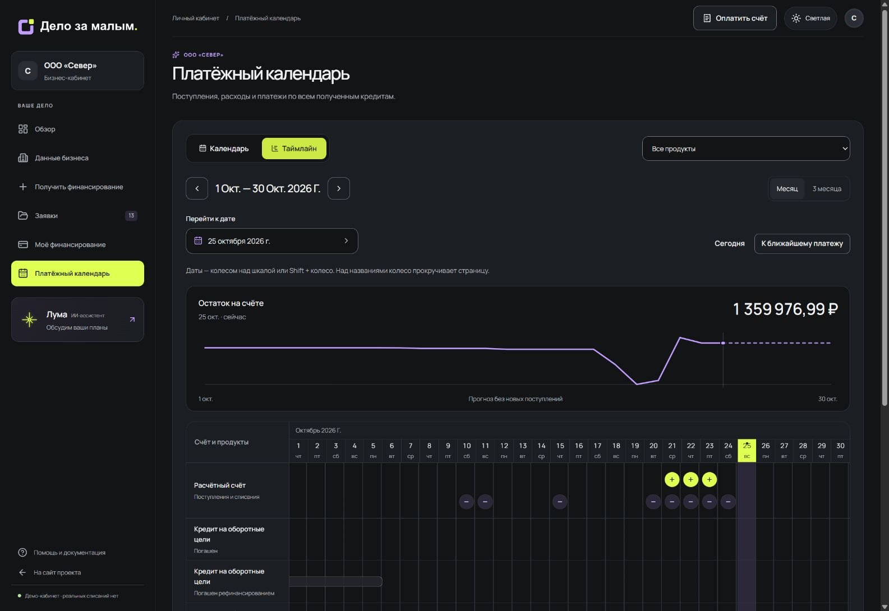

# Приёмка сдаваемой версии · 25.10.2026

Версия фиксируется тегом `submission-2026-10-25`. Проверки выполнялись локально
на Windows с Docker Desktop. Рабочие базы пользователя не заменялись.

## Наполненный кабинет

Сдаваемый снимок в `contracts/demo/` содержит 13 осмысленных заявок, пять активных
продуктов, 1 359 976,99 ₽ на счёте, 111 событий календаря, четыре оплаты поставщикам,
PDF-счёт и сохранённый диалог. Есть полностью погашенный кредит, рефинансированный
кредит, операции по линии, использование и автопогашение овердрафта. Черновики,
уточнение взноса, готовые предложения и договор к подписанию доступны для просмотра.

Снимок собран обычными сервисами через `scripts.build_submission_snapshot`:
баланс не подменяется, ограничения продуктов и скоринг не отключаются. Тест
проверяет также новое предложение на 1 млн ₽ поверх действующего портфеля.
SHA-256, размер и количество записей сохранены в `hackathon-snapshot.json`.

## Результаты

| Проверка | Результат |
|---|---|
| Полный backend: `uv run --frozen python -m unittest discover -s tests` | 521 тест: 520 пройдено, 1 пропущен — создание symlink недоступно в текущем Windows |
| Frontend unit | 160 пройдено; 20 интеграционных тестов в обычном запуске отключены |
| Полный официальный UI/API-раннер: `scripts.run_frontend_checks` | Все 20 интеграционных тестов пройдены, отдельные временные базы для трёх наборов |
| Корневой Dockerfile, закреплённые образы и lock-файлы | Успешная сборка `alfa-submission:20261025` |
| `start_hackathon --without-ai` на новом томе | Healthy; без ключа и модели; новая заявка 300 000 ₽ прошла проверки, выбор, подписание и выдачу; счёт и календарь обновились |
| Обычный `start_hackathon` на другом новом томе | Dahl, `CHAT_MODE=model`, ровно 13 исходных заявок, пять продуктов, исходный денежный резерв |
| Dahl из нового контейнера: `/models` и генерация JSON | Пройдено за 83,97 с, включая один повтор после тайм-аута; контракт backend соблюдён |
| Перезапуск нового API-контейнера | Сохранились 13 заявок, баланс 1 359 976,99 ₽ и режим модели |
| Визуальная проверка | Обзор, пять продуктов, календарь, таймлайн и сохранённый диалог открываются с данными |
| Центрирование промо-продуктов | В проверенном viewport 1280×720 центр карточки совпадает с центром колонки, поворот убран, горизонтального переполнения нет |
| Обложка README / HyperFrames 0.8.197 | Check без ошибок разметки, runtime, layout и контраста; статичный PNG просмотрен |

Прямой запуск интеграционных тестов на наполненном демонстрационном сервере
с банковской задержкой оказался неподходящим: тесты ожидают изоляцию данных и
отдельный API. Этот запуск остановлен и не считается приёмкой. Полный штатный
раннер выше прошёл без выборочного перезапуска тестов. Его временные базы не входят
в сдаваемый снимок.

## Практические ограничения

У сборки остаётся предупреждение о JS-чанке кабинета более 500 kB. Свободный диалог
зависит от задержки и доступности выбранного инференса: успешная проверка Dahl не
означает мгновенные ответы или гарантированную квоту. Gemma на этой машине заново
не аттестована; инструкция её отдельной проверки сохранена в документации.

Жюри `alfa-hack-2026` приглашено в приватный личный репозиторий с правом записи
после явного согласования с владельцем; на момент проверки приглашение ещё не
принято. VPS и видео добавляются в единственный файл `submission/links.txt` после
публикации реальных адресов.
